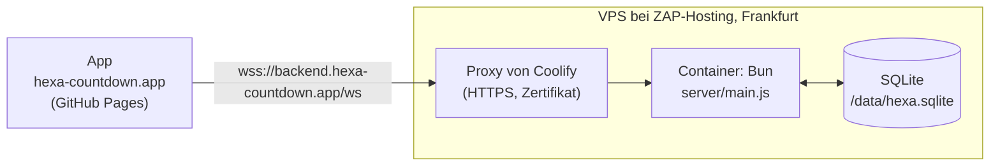

# Umzug auf Bun und eigenen Server – Konzept

> Gehört zu [#16](https://github.com/unpacked-dev/hexa/issues/16). Stand: 23. Oktober 2026. Die Annahmen unter [Vorab geprüft](#vorab-geprüft) sind mit Bun 1.3.11 und Docker ausprobiert, nicht nur nachgelesen.

## Kurz gesagt

- Der Online-Server zieht von **Deno Deploy mit Deno KV** auf **Bun in einem Docker-Container**. Betrieben wird er mit **Coolify** auf dem eigenen VPS bei **ZAP-Hosting** in Frankfurt. Die App auf GitHub Pages bleibt, wie sie ist.
- Statt Deno KV speichert der Server alles in **einer SQLite-Datei** auf einem Volume. Laufende Spiele überstehen so jedes Update.
- Es gibt nur noch **einen Server**. Damit fällt alles weg, was es nur für mehrere Instanzen gab: Beobachten, Nachfragen, Lebenszeichen, gemerkte Versionen und Wiederholen bei Konflikten. Der Server wird spürbar kürzer und einfacher.
- **Kein Datenexport aus Deno KV.** Am Umzugstag geht Online kurz aus, der Server zieht um, dann geht Online wieder an. Die Statistik fängt auf dem neuen Server bei null an.
- Das **Protokoll bleibt Version 3**. Die App braucht keine neue Version, sie spricht weiter mit `wss://backend.hexa-countdown.app/ws`.
- Bis zum Umzugstag bleibt `main` auf Deno. Gearbeitet wird in einem eigenen Branch, denn Deno Deploy baut jeden Push auf `main`.

## Entschieden

- Bun im Docker-Container, Coolify, VPS bei ZAP-Hosting in Frankfurt am Main (14.10.2026).
- Der Server liefert die App weiter selbst aus, jetzt über Bun (14.10.2026).
- Für Deno wird nichts mehr entwickelt, auch keine neuen Funktionen am Server vor dem Umzug (23.10.2026).
- Kein Export aus Deno KV. Online wird zum Umzug abgeschaltet, die KV kurz danach gelöscht. Laufende Spiele gibt es dann keine, die Zähler der Statistik dürfen verloren gehen. Konten gibt es ohnehin nicht (23.10.2026).
- Die Online-Logik wird vereinfacht, weil alle Verbindungen über denselben Server laufen (23.10.2026).

## Was anders ist als im Issue

| Im Issue #16 | Jetzt | Warum |
|---|---|---|
| Kleiner Nachbau von Deno KV (`server/kv.js`) auf SQLite | SQLite direkt, mit zwei einfachen Tabellen | Mit einem Server braucht es weder Versionen noch `watch`. Ein Nachbau würde eine tote API am Leben halten. |
| Statistik aus Deno KV exportieren | Kein Export | Entschieden. Ging auch nicht so einfach: Laut Deno-Doku kommt man an die KV des neuen Deno Deploy nicht von außen heran. |
| `js/config.js`, `rules.js`, `bot.js` laufen in Bun unverändert | Laufen, aber der Server muss sie anders laden | Siehe [Vorab geprüft](#vorab-geprüft), Punkt 1 |
| IP für die Bremsen: `X-Forwarded-For` prüfen | Letzter Eintrag von `X-Forwarded-For`, nur wenn die Anfrage vom Proxy kommt | Sonst teilen sich alle Leute eine Adresse, und die Bremsen greifen für alle |
| Image `oven/bun` | `oven/bun:1.3.11-alpine` | Kleiner, und `wget` ist dabei. Den braucht der Health Check von Coolify. |
| Fliegender Wechsel per DNS | Online kurz aus, umziehen, Online an | Einfacher und ohne Lobbys, die halb auf dem alten und halb auf dem neuen Server hängen |

## Vorab geprüft

Ausprobiert mit Bun 1.3.11 hier in der Sandbox und mit den offiziellen Docker-Images.

1. **Die gemeinsamen Dateien aus `js/` kommen so nicht an.** `server/game.js` lädt sie heute mit `import '../js/config.js'` und liest dann `globalThis.HexaConfig`. In Bun bleibt das leer: Bun erkennt `module.exports` in den Dateien und behandelt sie als CommonJS. Dann landet alles in `module.exports` und nicht auf `globalThis`. **Lösung:** `import Config from '../js/config.js'` (ebenso `Rules` und `Bot`). Im Browser und in Node ändert sich nichts. Mit dieser kleinen Änderung laufen **alle 24 Tests der Spiellogik** unter Bun. Betroffen sind `server/game.js`, `server/main.js` (`enableOnline`) und zwei Stellen in den Tests.
2. **`bun test` ohne Pfad findet auch die App-Tests** in `tests/` (die mit `node:test`). Die laufen in Bun sogar, 41 von 41. Trotzdem bekommt der Server eigene Befehle: `bun test server/`. Die App-Tests bleiben bei `node --test`.
3. **SQLite in Bun** (`bun:sqlite`, SQLite 3.51): WAL und `INSERT … ON CONFLICT … DO UPDATE` funktionieren. Drei Prozesse haben gleichzeitig je 2000-mal gelesen, gerechnet und geschrieben, mit Schreibsperre (`BEGIN IMMEDIATE`). Am Ende standen genau 6000 da, nichts ging verloren. **Wichtig:** `busy_timeout` muss vor dem Umschalten auf WAL gesetzt werden. Sonst bricht der zweite Prozess beim Start mit „database is locked“ ab.
4. **`Bun.serve`** mit WebSocket (`server.upgrade(req, { data })`, `ws.data`) und `server.requestIP(req)` läuft wie erwartet.
5. **Docker-Image:** `oven/bun:1.3.11-alpine` hat 153 MB (`slim` hat 255 MB). Es bringt `wget` mit, `slim` hat weder `curl` noch `wget`. Den Nutzer `bun` (uid 1000) gibt es. Zeitzone `Europe/Berlin` und deutsches Zahlenformat stimmen, das braucht die Statistik.
6. **Anhalten:** Ohne eigene Behandlung von `SIGTERM` braucht `docker stop` 10,2 Sekunden, weil Bun das Signal ignoriert und am Ende hart beendet wird. Mit Behandlung sind es 0,16 Sekunden.

## Zielbild



## Der Server mit Bun

### Was sich ändert

| Heute (Deno) | Mit Bun |
|---|---|
| `Deno.serve(hub.handle)` | `Bun.serve({ port, fetch, websocket })`. `createHub` liefert `fetch` und `websocket` dafür. |
| `Deno.upgradeWebSocket` mit `socket.onmessage`, `onclose` | `server.upgrade(req, { data: c })`, dazu `websocket: { open, message, close }`. Die Verbindung `c` steckt in `ws.data`. |
| `info.remoteAddr.hostname` | `server.requestIP(req)`, hinter dem Proxy `X-Forwarded-For` (siehe unten) |
| `Deno.readFile` | `Bun.file(…)` |
| `Deno.env.get` | `process.env` |
| `Deno.openKv` | `openDb(pfad)` aus dem neuen `server/db.js` |
| `Deno.KvU64` in `stats.js` | Fällt weg, SQLite zählt mit normalen Zahlen |
| `import.meta.main` | Bleibt, Bun kennt es auch |
| `Deno.test` | `import { test } from 'bun:test'` |
| `deno.json` | `package.json` mit `dev`, `start` und `test`, ohne Abhängigkeiten |

`crypto.subtle`, `structuredClone`, `Response.json`, `Intl` und `fetch` laufen in Bun unverändert.

### Datenbank: SQLite statt Deno KV

Zwei Tabellen in einer Datei. Den Pfad bestimmt `HEXA_DB`, im Container `/data/hexa.sqlite`, lokal `./hexa.sqlite`, in Tests `:memory:`.

```sql
CREATE TABLE rooms (
  code    TEXT PRIMARY KEY,    -- KXMP
  data    TEXT NOT NULL,       -- ganzer Stand als JSON, wie heute
  expires INTEGER NOT NULL     -- ms, danach gilt die Lobby als weg
);
CREATE TABLE stats (
  scope  TEXT NOT NULL,        -- day | hour | total
  bucket TEXT NOT NULL,        -- 2026-10-12 | 2026-10-12T14 | ''
  kind   TEXT NOT NULL,        -- online | local | daily
  n      INTEGER NOT NULL,
  PRIMARY KEY (scope, bucket, kind)
);
```

- **Lobby ändern** wird ein einziger Schritt mit Schreibsperre: lesen, rechnen, schreiben. `bun:sqlite` arbeitet synchron, dazwischen kann nichts anderes passieren. Es braucht also keine Versionen, kein Wiederholen und keinen gemerkten Stand. Eine Lobby zu lesen dauert lokal Mikrosekunden statt 15 bis 45 ms wie bei Deno KV.
- **Neue Lobby:** Code ziehen, prüfen, ob er frei ist, anlegen. Auch das in einem Schritt.
- **Statistik:** Ein Spiel zählen sind drei `INSERT … ON CONFLICT DO UPDATE SET n = n + 1` in einem Schritt. Lesen geht mit `SUM(n)` und `WHERE bucket >= ?`. Alte Stunden löscht ein einfaches `DELETE`.
- **Aufräumen:** Einmal pro Stunde `DELETE FROM rooms WHERE expires < jetzt`. Die eigene Prüfung `isLive` bleibt.
- **Einstellungen beim Öffnen**, in dieser Reihenfolge: `busy_timeout = 5000`, `journal_mode = WAL`, `synchronous = NORMAL`.
- Die Funktionen in `store.js` und `stats.js` behalten ihre Namen (`createRoom`, `mutate`, `readRoom`, `countGame`, `readStats`, `pruneHours`, `statsPage`). So ändert sich `main.js` wenig, und die meisten Tests behalten ihre Prüfungen.
- Das Präfix `hexa_` fällt weg. Die Datei gehört nur HEXA.

### Online-Logik vereinfachen

Alle Verbindungen laufen über denselben Server. Das fällt weg:

| Fällt weg | Wo | Ersatz |
|---|---|---|
| Beobachten mit `kv.watch()` und Nachfragen alle 5 Sekunden (`watchRoom`, `HEXA_POLL_MS`) | `store.js`, `main.js` | Nichts. Der Server verteilt jeden neuen Stand direkt nach der Änderung, wie heute schon. |
| Lebenszeichen der Instanzen (`heartbeat`, `liveInstances`, `forgetInstance`, `hexa_instance`, Takt alle 10 Sekunden) | `store.js`, `main.js` | Nichts |
| Gemerkter Stand mit Version (`known`, `L.entry`, `versionstamp`) | `store.js`, `main.js` | Nichts, SQLite ist schnell genug |
| Wiederholen bei Konflikten (12 Versuche mit kurzen Pausen) | `store.js` | Schreibsperre |
| „Eine andere Instanz war schneller“ und der Zufallsversatz bei den Timern | `main.js` | Nichts |
| Verbindungen fremder Instanzen aufräumen | `game.js` (`prune`) | Bleibt, aber einfacher: Nur die eigene Instanz läuft. Verbindungen von vor einem Neustart fallen nach 40 Sekunden weg. |

Zusammen sind das gut 100 Zeilen weniger in `main.js` und `store.js`. **Gleich bleiben** Spiellogik (`game.js`), Protokoll, Nachrichten, Fehlercodes, Bots, Zugzeit und Bremsen.

**Warum die Schreibsperre trotzdem nötig ist:** Bei jedem Update startet Coolify den neuen Container, wartet auf den Health Check und hält erst dann den alten an. Für ein paar Sekunden laufen also zwei Server an derselben Datei. Mit der Schreibsperre geht dabei nichts verloren (siehe Punkt 3 oben). Wer in diesen Sekunden am alten Server hängt, sieht Züge vom neuen erst nach dem Wiederverbinden. Das passiert gleich danach, weil der alte Server beim Anhalten alle Verbindungen schließt.

### IP-Adresse hinter dem Proxy

Die Bremsen zählen pro Internetverbindung (höchstens 20 Verbindungen, 6 neue Lobbys pro Minute). Hinter dem Proxy von Coolify sieht `server.requestIP` aber nur die Adresse des Proxys. Dann würden sich alle Leute eine Adresse teilen, und die Bremsen griffen für alle zugleich.

- Kommt die Anfrage aus einem privaten Netz (also vom Proxy), nimmt der Server den **letzten** Eintrag von `X-Forwarded-For`. Den hängt der Proxy selbst an, fälschen lässt er sich nicht.
- Kommt sie direkt, zählt die Adresse der Verbindung.
- Port 8000 des Containers wird nicht nach außen freigegeben. So geht niemand am Proxy vorbei.
- `ipKey` (IPv6 pro /64-Netz) bleibt, wie es ist. Dazu kommt ein Test für die neue Regel.

### Sauber anhalten

`docker stop` schickt `SIGTERM`. Ohne eigene Behandlung ignoriert Bun das als erster Prozess im Container und wird nach 10 Sekunden hart beendet (siehe [Vorab geprüft](#vorab-geprüft), Punkt 6). Deshalb:

- Bei `SIGTERM` keine neuen Verbindungen mehr annehmen, alle WebSockets mit `1001` schließen, die Datenbank schließen, beenden.
- Die App verbindet sich von selbst neu (nach 0,4 Sekunden, dann immer etwas später, höchstens alle 8 Sekunden) und bekommt den ganzen Stand.

### Kleinigkeiten

- `maxPayloadLength` für WebSockets auf 16 KB. Bun nimmt sonst bis zu 16 MB an, der Server prüft erst danach auf 4096 Zeichen.
- `idleTimeout` bleibt bei 60 Sekunden.
- Deno komprimiert Antworten von selbst, Bun nicht. Das ist egal: In der Produktion leitet die Startseite zur App auf GitHub Pages weiter. Falls nötig, kann der Proxy von Coolify komprimieren.
- `REDIRECT_HOSTS` nur noch mit `backend.hexa-countdown.app`.
- `hexa.sqlite*` kommt in die `.gitignore`.

## Tests

- `Deno.test(…)` wird zu `test(…)` aus `bun:test`. Die Prüfungen mit `node:assert` bleiben.
- **Zeitlimit:** Bun bricht einen Test nach 5 Sekunden ab, Deno nicht. Ganze Partien über WebSocket dauern länger. Deshalb `bun test --timeout 30000 server/`.
- Tests mit zwei Instanzen laufen künftig mit einem Server. Die Tests für Beobachten, Lebenszeichen und gemerkten Stand fallen weg.
- **Neu:**
  - Neustart: Ein zweiter Server an derselben Datei übernimmt eine laufende Lobby, die Leute verbinden neu und spielen weiter.
  - IP hinter dem Proxy: letzter Eintrag von `X-Forwarded-For`, aber nur aus einem privaten Netz.
  - Sauber anhalten: Verbindungen gehen mit `1001` zu.
- **CI:** Der Job „Server-Tests“ nutzt `oven-sh/setup-bun@v2` mit fester Version und `bun run test`. Dazu kommt ein Schritt `docker build`, damit ein kaputtes Dockerfile sofort auffällt. Die App-Tests bleiben bei Node.

## Dockerfile

Ungefähr so:

```dockerfile
# HEXA – Online-Server. Bun-Version zusammen mit .github/workflows/ci.yml ändern.
FROM oven/bun:1.3.11-alpine
WORKDIR /app
ENV NODE_ENV=production PORT=8000 HEXA_DB=/data/hexa.sqlite

# Keine Pakete, also kein bun install. Nur was der Server braucht und ausliefert.
COPY package.json ./
COPY server/ server/
COPY js/ js/
COPY css/ css/
COPY lang/ lang/
COPY fonts/ fonts/
COPY icons/ icons/
COPY index.html sw.js manifest.webmanifest favicon.svg ./

# Das Volume übernimmt beim ersten Start den Besitzer dieses Ordners
RUN mkdir -p /data && chown bun:bun /data
USER bun

EXPOSE 8000
HEALTHCHECK --interval=10s --timeout=3s --start-period=5s --retries=3 \
  CMD wget -q -O /dev/null http://127.0.0.1:8000/health || exit 1
CMD ["bun", "server/main.js"]
```

- Dazu eine `.dockerignore` (`.git`, `docs/`, `tools/`, `tests/`, `server/tests/`), damit nur wenig zum Bauen geschickt wird.
- Coolify nimmt den `HEALTHCHECK` aus dem Dockerfile von selbst.
- Lokal prüfen mit `docker build` und `docker run` samt Volume: App öffnen, Lobby erstellen, Container neu starten, Lobby ist noch da.

## Coolify und VPS

| Einstellung | Wert |
|---|---|
| Quelle | GitHub-Repo über die GitHub App von Coolify, dann baut jeder Push neu |
| Build Pack | Dockerfile |
| Branch | `main`. Die Test-Anwendung nimmt den Umzugs-Branch. |
| Domain | `https://backend.hexa-countdown.app`. Test: eigene Subdomain, Vorschlag `test.hexa-countdown.app`. |
| Ports Exposes | `8000` |
| Ports Mappings | leer lassen. Sonst klappen die Updates ohne Pause nicht, und man käme am Proxy vorbei. |
| Persistent Storage | Volume nach `/data` |
| Umgebungsvariablen | keine nötig, `PORT` und `HEXA_DB` stehen im Dockerfile |
| Health Check | aus dem Dockerfile |
| Benachrichtigung | E-Mail (oder Telegram, Discord) bei fehlgeschlagenem Deploy und wenn der Container ausfällt |

Optional: **Watch Paths**, damit reine Doku-Änderungen keinen neuen Build auslösen.

**Grundschutz für den VPS**, falls noch nicht erledigt:

- Firewall nur für 22, 80 und 443.
- Das Dashboard von Coolify unter einer eigenen Domain mit HTTPS. Seinen Port 8000 auf dem Host schließen. Kein Konflikt mit HEXA, denn dessen Port 8000 bleibt im Container.
- SSH nur mit Schlüssel.
- Automatische Sicherheitsupdates.

**Backups:** Wichtig sind nur die Zähler der Statistik, Lobbys leben höchstens 24 Stunden. Es reicht eine geplante Aufgabe in Coolify (*Scheduled Tasks*), die täglich `VACUUM INTO '/data/backup-<datum>.sqlite'` ausführt und alte Kopien nach 7 Tagen löscht. Eine Kopie außerhalb des VPS ist möglich, aber nicht nötig.

## Branches: `main` bleibt bis zum Umzug auf Deno

Deno Deploy baut jeden Push auf `main`. Käme der Bun-Code vorher auf `main`, wäre der Server in der Produktion kaputt.

- Gearbeitet wird in einem Branch, Vorschlag `umzug-bun`, mit einem Entwurf-PR gegen `main`. Jeder Schritt wird ein eigener Commit, die CI läuft bei jedem Push.
- App-Änderungen gehen weiter auf `main` (GitHub Pages). `main` wird regelmäßig in den Branch gemergt. Am Server auf `main` ändert sich nichts mehr.
- Die Test-Anwendung in Coolify baut aus diesem Branch.
- Gemergt wird erst am Umzugstag. Bis Ende Januar muss niemand warten: Sobald VPS, Testlauf und AVV fertig sind, kann umgezogen werden. Je kürzer der Branch lebt, desto weniger Merges.

## Umzugstag

**Vorher erledigt:**

- AVV mit ZAP-Hosting ([#7](https://github.com/unpacked-dev/hexa/issues/7)). Ab jetzt liegen echte Spitznamen auf dem VPS.
- Auf der Testadresse mit zwei Geräten durchgespielt: Lobby, ganze Partie, Bots, eigene Würfel, Wiederverbinden, Neuladen. Dazu ein Update mitten im Spiel: Push auf den Branch, das Spiel muss danach weiterlaufen.
- Am Tag vorher die TTL des DNS-Eintrags `backend` bei Spaceship auf 5 Minuten senken.
- Prüfen, ob der VPS eine IPv6-Adresse hat (für AAAA) und ob ein CAA-Eintrag Let's Encrypt erlaubt (falls es einen gibt).

**Ablauf:**

1. **Online aus:** `enableOnline: false` in `js/config.js` auf `main`. Die App graut „Online“ aus, der Deno-Server lehnt neue Verbindungen ab.
2. **Merge** des Umzugs-Branch in `main`, `enableOnline` bleibt dabei aus. Coolify baut die Produktion. Deno Deploy baut auch, aber der Bun-Code läuft dort nicht. Das ist egal, Online ist ja aus.
3. **DNS bei Spaceship:** `backend` von CNAME `alias.deno.net` auf A zur IPv4 des VPS, dazu AAAA, falls vorhanden. `_acme-challenge.backend` löschen.
4. Warten, bis `backend.hexa-countdown.app` auf den VPS zeigt und Coolify das Zertifikat geholt hat (meist wenige Minuten).
5. **Prüfen:** `/health` zeigt `"online": false`, `/stats` lädt.
6. **Online an:** `enableOnline: true` auf `main`. Coolify baut neu, GitHub Pages auch.
7. **Prüfen:** ein Online-Spiel mit zwei Geräten, Bots, `/stats` zählt.
8. **Deno Deploy aufräumen**, wenn alles läuft (am selben oder nächsten Tag): die App „hexa“ löschen und die Daten in Deno KV. **Vorher prüfen, ob die Datenbank „unpacked“ noch von anderen Apps der Organisation genutzt wird.** Dann nur die HEXA-Schlüssel löschen oder warten, bis Deno Deploy abgeschaltet wird.

Online ist von Schritt 1 bis 6 aus, etwa eine halbe bis eine Stunde. Lokale Spiele und das Tagesspiel laufen ganz normal weiter. Nur ihre Meldungen an die Statistik gehen in dieser Zeit verloren.

**Zurück, falls etwas schiefgeht:** Solange die App auf Deno Deploy noch existiert, den Merge auf `main` rückgängig machen und den DNS-Eintrag zurückstellen. Deshalb erst nach Schritt 7 löschen.

## Aufräumen

Das meiste davon gehört schon in den Branch, damit `main` nach dem Merge gleich stimmt:

- `deno.json` löschen.
- **Doku:**
  - `server/README.md`: Einrichten mit Coolify statt Deno Deploy, Betrieb, Abschnitt zu mehreren Instanzen raus, Umgebungsvariablen, Datenbank-Tabellen.
  - `README.md`: Technik, Projektstruktur, lokal starten mit `bun run dev`, Tests mit `bun run test`.
  - `docs/online-konzept.md`: Hinweis zum Stand.
  - `CHANGELOG.md`: Eintrag unter „Geändert“.
- **Kommentare, die Deno nennen:** `js/config.js` (auch der Hinweis zum kostenlosen Tarif bei `enableOnline`), `js/online.js`, `js/bot.js`, `js/daily.js` und die Testdateien.
- **Datenschutz** ([#6](https://github.com/unpacked-dev/hexa/issues/6)): Der Server steht jetzt bei ZAP-Hosting in Frankfurt statt bei Deno in den USA. Das gehört in den Datenschutztext, sobald es ihn gibt.
- [#9](https://github.com/unpacked-dev/hexa/issues/9) (Grenzen des kostenlosen Tarifs von Deno Deploy) kann danach zu.
- Ab und zu, etwa einmal im Monat, Arbeitsspeicher, CPU und Platz auf dem VPS anschauen.

## Reihenfolge der Arbeit

| # | Paket | Wer | Ergebnis |
|---|---|---|---|
| 1 | Server auf Bun: `db.js`, `store.js` und `stats.js` auf SQLite, `main.js` auf `Bun.serve`, Online-Logik vereinfachen, IP hinter dem Proxy, sauber anhalten, Imports aus `js/` | Claude | Alle Server-Tests grün mit `bun test` |
| 2 | `package.json`, CI auf Bun, `deno.json` weg | Claude | CI grün im Entwurf-PR |
| 3 | `Dockerfile`, `.dockerignore`, lokal gebaut und gestartet | Claude | Container läuft, Lobby übersteht Neustart |
| 4 | Doku, Kommentare, Changelog | Claude | `main` stimmt nach dem Merge |
| 5 | VPS absichern, Coolify mit GitHub App, Test-Anwendung aus dem Branch, DNS für die Testadresse | du (Anleitung von Claude) | Testadresse läuft |
| 6 | AVV mit ZAP-Hosting ([#7](https://github.com/unpacked-dev/hexa/issues/7)) | du | unterschrieben |
| 7 | Durchspielen auf echten Geräten, Update mitten im Spiel | du | ok |
| 8 | Umzugstag | du, Claude für die Commits | Online läuft auf dem VPS |

Die Pakete 1 bis 4 und 5 bis 6 können gleichzeitig laufen.

## Risiken

| Risiko | Folge | Dagegen |
|---|---|---|
| Beim Update laufen kurz zwei Server an derselben Datei | Ohne Sperre könnten Züge verloren gehen | Schreibsperre, alter Server schließt Verbindungen sofort, Test dafür |
| Bremsen sehen nur die Adresse des Proxys | Alle werden gemeinsam gebremst | `X-Forwarded-For` wie oben, Test dafür, auf der Testadresse mit zwei Netzen (WLAN und Mobilfunk) ausprobieren |
| Zertifikat klappt nach dem DNS-Wechsel nicht | Online bleibt länger aus | Port 80 offen, CAA prüfen, Zurück-Weg (siehe oben) |
| VPS fällt aus | Online geht nicht | Benachrichtigung von Coolify. Lokal spielen geht weiter. |
| Platte voll | Server kann nicht schreiben | Lobbys räumen sich auf, die Statistik ist winzig. Einmal im Monat schauen. |
| Neue Bun-Version verhält sich anders | Tests oder Server brechen | Version fest im Dockerfile und in der CI, nur bewusst und zusammen erhöhen |

## Offen

- Name der Testadresse: `test.hexa-countdown.app`?
- Name des Branch: `umzug-bun`?
- Läuft Coolify schon auf dem VPS, und ist die GitHub App verbunden?
- Hat der VPS eine IPv6-Adresse?
- Nutzen andere Apps der Organisation die Datenbank „unpacked“ auf Deno Deploy?
- Reicht ein tägliches Backup auf dem VPS selbst?

## Quellen

- Ankündigung zu Deno und Cloudflare, Deno Deploy noch sechs Monate: [deno.com/blog/cloudflare](https://deno.com/blog/cloudflare)
- Kein Zugriff von außen auf die KV des neuen Deno Deploy: [docs.deno.com/deploy/kv/node](https://docs.deno.com/deploy/kv/node/)
- Health Checks in Coolify brauchen `curl` oder `wget` im Image, `HEALTHCHECK` aus dem Dockerfile: [coolify.io/docs/applications/configuration/health-checks](https://coolify.io/docs/applications/configuration/health-checks)
- Updates ohne Pause in Coolify, ohne Port-Mapping: [coolify.io/docs/applications/deployments/rolling-updates](https://coolify.io/docs/applications/deployments/rolling-updates)
