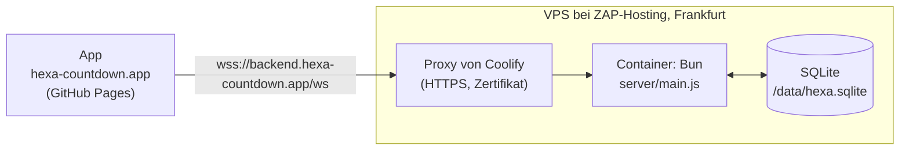

# Umzug auf Bun und eigenen Server – Konzept

> Gehört zu [#16](https://github.com/unpacked-dev/hexa/issues/16). Stand: 23. Oktober 2026. Die Annahmen unter [Vorab geprüft](#vorab-geprüft) sind mit Bun 1.3.11 und Docker ausprobiert, nicht nur nachgelesen.

## Kurz gesagt

- Der Online-Server zieht von **Deno Deploy mit Deno KV** auf **Bun in einem Docker-Container**. Betrieben wird er mit **Coolify** auf dem eigenen VPS bei **ZAP-Hosting** in Frankfurt. Die App auf GitHub Pages bleibt, wie sie ist.
- Statt Deno KV speichert der Server alles in **einer SQLite-Datei** auf einem Volume. Laufende Spiele überstehen so jedes Update.
- Es gibt nur noch **einen Server**. Damit fällt alles weg, was es nur für mehrere Instanzen gab: Beobachten, Nachfragen, Lebenszeichen, gemerkte Versionen und Wiederholen bei Konflikten. Der Server wird spürbar kürzer und einfacher.
- **Kein Datenexport aus Deno KV.** Am Umzugstag geht Online kurz aus, der Server zieht um, dann geht Online wieder an. Die Statistik fängt auf dem neuen Server bei null an.
- Das **Protokoll bleibt Version 3**. Die App braucht keine neue Version, sie spricht weiter mit `wss://backend.hexa-countdown.app/ws`.
- Bis zum Umzugstag bleibt `main` auf Deno. Gearbeitet wird in einem eigenen Branch, denn Deno Deploy baut jeden Push auf `main`.
- Die [Anleitung Schritt für Schritt](#anleitung-schritt-für-schritt) führt durch alles: VPS vorbereiten, Coolify einrichten, testen, Online aus, umziehen, Online an und Deno Deploy löschen.

## Entschieden

- Bun im Docker-Container, Coolify, VPS bei ZAP-Hosting in Frankfurt am Main (14.10.2026).
- Der Server liefert die App weiter selbst aus, jetzt über Bun (14.10.2026).
- Für Deno wird nichts mehr entwickelt, auch keine neuen Funktionen am Server vor dem Umzug (23.10.2026).
- Kein Export aus Deno KV. Online wird zum Umzug abgeschaltet, die KV kurz danach gelöscht. Laufende Spiele gibt es dann keine, die Zähler der Statistik dürfen verloren gehen. Konten gibt es ohnehin nicht (23.10.2026).
- Die Online-Logik wird vereinfacht, weil alle Verbindungen über denselben Server laufen (23.10.2026).

## Was anders ist als im Issue

| Im Issue #16 | Jetzt | Warum |
|---|---|---|
| Kleiner Nachbau von Deno KV (`server/kv.js`) auf SQLite | SQLite direkt, mit zwei einfachen Tabellen | Mit einem Server braucht es weder Versionen noch `watch`. Ein Nachbau würde eine tote API am Leben halten. |
| Statistik aus Deno KV exportieren | Kein Export | Entschieden. Ging auch nicht so einfach: Laut Deno-Doku kommt man an die KV des neuen Deno Deploy nicht von außen heran. |
| `js/config.js`, `rules.js`, `bot.js` laufen in Bun unverändert | Laufen, aber der Server muss sie anders laden | Siehe [Vorab geprüft](#vorab-geprüft), Punkt 1 |
| IP für die Bremsen: `X-Forwarded-For` prüfen | Letzter Eintrag von `X-Forwarded-For`, nur wenn die Anfrage vom Proxy kommt | Sonst teilen sich alle Leute eine Adresse, und die Bremsen greifen für alle |
| Image `oven/bun` | `oven/bun:1.3.11-alpine` | Kleiner, und `wget` ist dabei. Den braucht der Health Check von Coolify. |
| Fliegender Wechsel per DNS | Online kurz aus, umziehen, Online an | Einfacher und ohne Lobbys, die halb auf dem alten und halb auf dem neuen Server hängen |

## Vorab geprüft

Ausprobiert mit Bun 1.3.11 hier in der Sandbox und mit den offiziellen Docker-Images.

1. **Die gemeinsamen Dateien aus `js/` kommen so nicht an.** `server/game.js` lädt sie heute mit `import '../js/config.js'` und liest dann `globalThis.HexaConfig`. In Bun bleibt das leer: Bun erkennt `module.exports` in den Dateien und behandelt sie als CommonJS. Dann landet alles in `module.exports` und nicht auf `globalThis`. **Lösung:** `import Config from '../js/config.js'` (ebenso `Rules` und `Bot`). Im Browser und in Node ändert sich nichts. Mit dieser kleinen Änderung laufen **alle 24 Tests der Spiellogik** unter Bun. Betroffen sind `server/game.js`, `server/main.js` (`enableOnline`) und zwei Stellen in den Tests.
2. **`bun test` ohne Pfad findet auch die App-Tests** in `tests/` (die mit `node:test`). Die laufen in Bun sogar, 41 von 41. Trotzdem bekommt der Server eigene Befehle: `bun test server/`. Die App-Tests bleiben bei `node --test`.
3. **SQLite in Bun** (`bun:sqlite`, SQLite 3.51): WAL und `INSERT … ON CONFLICT … DO UPDATE` funktionieren. Drei Prozesse haben gleichzeitig je 2000-mal gelesen, gerechnet und geschrieben, mit Schreibsperre (`BEGIN IMMEDIATE`). Am Ende standen genau 6000 da, nichts ging verloren. **Wichtig:** `busy_timeout` muss vor dem Umschalten auf WAL gesetzt werden. Sonst bricht der zweite Prozess beim Start mit „database is locked“ ab.
4. **`Bun.serve`** mit WebSocket (`server.upgrade(req, { data })`, `ws.data`) und `server.requestIP(req)` läuft wie erwartet.
5. **Docker-Image:** `oven/bun:1.3.11-alpine` hat 153 MB (`slim` hat 255 MB). Es bringt `wget` mit, `slim` hat weder `curl` noch `wget`. Den Nutzer `bun` (uid 1000) gibt es. Zeitzone `Europe/Berlin` und deutsches Zahlenformat stimmen, das braucht die Statistik.
6. **Anhalten:** Ohne eigene Behandlung von `SIGTERM` braucht `docker stop` 10,2 Sekunden, weil Bun das Signal ignoriert und am Ende hart beendet wird. Mit Behandlung sind es 0,16 Sekunden.

## Zielbild



## Der Server mit Bun

### Was sich ändert

| Heute (Deno) | Mit Bun |
|---|---|
| `Deno.serve(hub.handle)` | `Bun.serve({ port, fetch, websocket })`. `createHub` liefert `fetch` und `websocket` dafür. |
| `Deno.upgradeWebSocket` mit `socket.onmessage`, `onclose` | `server.upgrade(req, { data: c })`, dazu `websocket: { open, message, close }`. Die Verbindung `c` steckt in `ws.data`. |
| `info.remoteAddr.hostname` | `server.requestIP(req)`, hinter dem Proxy `X-Forwarded-For` (siehe unten) |
| `Deno.readFile` | `Bun.file(…)` |
| `Deno.env.get` | `process.env` |
| `Deno.openKv` | `openDb(pfad)` aus dem neuen `server/db.js` |
| `Deno.KvU64` in `stats.js` | Fällt weg, SQLite zählt mit normalen Zahlen |
| `import.meta.main` | Bleibt, Bun kennt es auch |
| `Deno.test` | `import { test } from 'bun:test'` |
| `deno.json` | `package.json` mit `dev`, `start` und `test`, ohne Abhängigkeiten |

`crypto.subtle`, `structuredClone`, `Response.json`, `Intl` und `fetch` laufen in Bun unverändert.

### Datenbank: SQLite statt Deno KV

Zwei Tabellen in einer Datei. Den Pfad bestimmt `HEXA_DB`, im Container `/data/hexa.sqlite`, lokal `./hexa.sqlite`, in Tests `:memory:`.

```sql
CREATE TABLE rooms (
  code    TEXT PRIMARY KEY,    -- KXMP
  data    TEXT NOT NULL,       -- ganzer Stand als JSON, wie heute
  expires INTEGER NOT NULL     -- ms, danach gilt die Lobby als weg
);
CREATE TABLE stats (
  scope  TEXT NOT NULL,        -- day | hour | total
  bucket TEXT NOT NULL,        -- 2026-10-12 | 2026-10-12T14 | ''
  kind   TEXT NOT NULL,        -- online | local | daily
  n      INTEGER NOT NULL,
  PRIMARY KEY (scope, bucket, kind)
);
```

- **Lobby ändern** wird ein einziger Schritt mit Schreibsperre: lesen, rechnen, schreiben. `bun:sqlite` arbeitet synchron, dazwischen kann nichts anderes passieren. Es braucht also keine Versionen, kein Wiederholen und keinen gemerkten Stand. Eine Lobby zu lesen dauert lokal Mikrosekunden statt 15 bis 45 ms wie bei Deno KV.
- **Neue Lobby:** Code ziehen, prüfen, ob er frei ist, anlegen. Auch das in einem Schritt.
- **Statistik:** Ein Spiel zählen sind drei `INSERT … ON CONFLICT DO UPDATE SET n = n + 1` in einem Schritt. Lesen geht mit `SUM(n)` und `WHERE bucket >= ?`. Alte Stunden löscht ein einfaches `DELETE`.
- **Aufräumen:** Einmal pro Stunde `DELETE FROM rooms WHERE expires < jetzt`. Die eigene Prüfung `isLive` bleibt.
- **Einstellungen beim Öffnen**, in dieser Reihenfolge: `busy_timeout = 5000`, `journal_mode = WAL`, `synchronous = NORMAL`.
- Die Funktionen in `store.js` und `stats.js` behalten ihre Namen (`createRoom`, `mutate`, `readRoom`, `countGame`, `readStats`, `pruneHours`, `statsPage`). So ändert sich `main.js` wenig, und die meisten Tests behalten ihre Prüfungen.
- Das Präfix `hexa_` fällt weg. Die Datei gehört nur HEXA.

### Online-Logik vereinfachen

Alle Verbindungen laufen über denselben Server. Das fällt weg:

| Fällt weg | Wo | Ersatz |
|---|---|---|
| Beobachten mit `kv.watch()` und Nachfragen alle 5 Sekunden (`watchRoom`, `HEXA_POLL_MS`) | `store.js`, `main.js` | Nichts. Der Server verteilt jeden neuen Stand direkt nach der Änderung, wie heute schon. |
| Lebenszeichen der Instanzen (`heartbeat`, `liveInstances`, `forgetInstance`, `hexa_instance`, Takt alle 10 Sekunden) | `store.js`, `main.js` | Nichts |
| Gemerkter Stand mit Version (`known`, `L.entry`, `versionstamp`) | `store.js`, `main.js` | Nichts, SQLite ist schnell genug |
| Wiederholen bei Konflikten (12 Versuche mit kurzen Pausen) | `store.js` | Schreibsperre |
| „Eine andere Instanz war schneller“ und der Zufallsversatz bei den Timern | `main.js` | Nichts |
| Verbindungen fremder Instanzen aufräumen | `game.js` (`prune`) | Bleibt, aber einfacher: Nur die eigene Instanz läuft. Verbindungen von vor einem Neustart fallen nach 40 Sekunden weg. |

Zusammen sind das gut 100 Zeilen weniger in `main.js` und `store.js`. **Gleich bleiben** Spiellogik (`game.js`), Protokoll, Nachrichten, Fehlercodes, Bots, Zugzeit und Bremsen.

**Warum die Schreibsperre trotzdem nötig ist:** Bei jedem Update startet Coolify den neuen Container, wartet auf den Health Check und hält erst dann den alten an. Für ein paar Sekunden laufen also zwei Server an derselben Datei. Mit der Schreibsperre geht dabei nichts verloren (siehe Punkt 3 oben). Wer in diesen Sekunden am alten Server hängt, sieht Züge vom neuen erst nach dem Wiederverbinden. Das passiert gleich danach, weil der alte Server beim Anhalten alle Verbindungen schließt.

### IP-Adresse hinter dem Proxy

Die Bremsen zählen pro Internetverbindung (höchstens 20 Verbindungen, 6 neue Lobbys pro Minute). Hinter dem Proxy von Coolify sieht `server.requestIP` aber nur die Adresse des Proxys. Dann würden sich alle Leute eine Adresse teilen, und die Bremsen griffen für alle zugleich.

- Kommt die Anfrage aus einem privaten Netz (also vom Proxy), nimmt der Server den **letzten** Eintrag von `X-Forwarded-For`. Den hängt der Proxy selbst an, fälschen lässt er sich nicht.
- Kommt sie direkt, zählt die Adresse der Verbindung.
- Port 8000 des Containers wird nicht nach außen freigegeben. So geht niemand am Proxy vorbei.
- `ipKey` (IPv6 pro /64-Netz) bleibt, wie es ist. Dazu kommt ein Test für die neue Regel.

### Sauber anhalten

`docker stop` schickt `SIGTERM`. Ohne eigene Behandlung ignoriert Bun das als erster Prozess im Container und wird nach 10 Sekunden hart beendet (siehe [Vorab geprüft](#vorab-geprüft), Punkt 6). Deshalb:

- Bei `SIGTERM` keine neuen Verbindungen mehr annehmen, alle WebSockets mit `1001` schließen, die Datenbank schließen, beenden.
- Die App verbindet sich von selbst neu (nach 0,4 Sekunden, dann immer etwas später, höchstens alle 8 Sekunden) und bekommt den ganzen Stand.

### Kleinigkeiten

- Der Server hört auf `0.0.0.0`, wie bei Bun üblich. Nur auf `127.0.0.1` würde ihn der Proxy von Coolify nicht erreichen.
- `maxPayloadLength` für WebSockets auf 16 KB. Bun nimmt sonst bis zu 16 MB an, der Server prüft erst danach auf 4096 Zeichen.
- `idleTimeout` bleibt bei 60 Sekunden.
- Deno komprimiert Antworten von selbst, Bun nicht. Das ist egal: In der Produktion leitet die Startseite zur App auf GitHub Pages weiter. Falls nötig, kann der Proxy von Coolify komprimieren.
- `REDIRECT_HOSTS` nur noch mit `backend.hexa-countdown.app`.
- `hexa.sqlite*` kommt in die `.gitignore`.

## Tests

- `Deno.test(…)` wird zu `test(…)` aus `bun:test`. Die Prüfungen mit `node:assert` bleiben.
- **Zeitlimit:** Bun bricht einen Test nach 5 Sekunden ab, Deno nicht. Ganze Partien über WebSocket dauern länger. Deshalb `bun test --timeout 30000 server/`.
- Tests mit zwei Instanzen laufen künftig mit einem Server. Die Tests für Beobachten, Lebenszeichen und gemerkten Stand fallen weg.
- **Neu:**
  - Neustart: Ein zweiter Server an derselben Datei übernimmt eine laufende Lobby, die Leute verbinden neu und spielen weiter.
  - IP hinter dem Proxy: letzter Eintrag von `X-Forwarded-For`, aber nur aus einem privaten Netz.
  - Sauber anhalten: Verbindungen gehen mit `1001` zu.
- **CI:** Der Job „Server-Tests“ nutzt `oven-sh/setup-bun@v2` mit fester Version und `bun run test`. Dazu kommt ein Schritt `docker build`, damit ein kaputtes Dockerfile sofort auffällt. Die App-Tests bleiben bei Node.

## Dockerfile

Ungefähr so:

```dockerfile
# HEXA – Online-Server. Bun-Version zusammen mit .github/workflows/ci.yml ändern.
FROM oven/bun:1.3.11-alpine
WORKDIR /app
ENV NODE_ENV=production PORT=8000 HEXA_DB=/data/hexa.sqlite

# Keine Pakete, also kein bun install. Nur was der Server braucht und ausliefert.
COPY package.json ./
COPY server/ server/
COPY js/ js/
COPY css/ css/
COPY lang/ lang/
COPY fonts/ fonts/
COPY icons/ icons/
COPY index.html sw.js manifest.webmanifest favicon.svg ./

# Das Volume übernimmt beim ersten Start den Besitzer dieses Ordners
RUN mkdir -p /data && chown bun:bun /data
USER bun

EXPOSE 8000
HEALTHCHECK --interval=10s --timeout=3s --start-period=5s --retries=3 \
  CMD wget -q -O /dev/null http://127.0.0.1:8000/health || exit 1
CMD ["bun", "server/main.js"]
```

- Dazu eine `.dockerignore` (`.git`, `docs/`, `tools/`, `tests/`, `server/tests/`), damit nur wenig zum Bauen geschickt wird.
- Coolify nimmt den `HEALTHCHECK` aus dem Dockerfile von selbst.
- Lokal prüfen mit `docker build` und `docker run` samt Volume: App öffnen, Lobby erstellen, Container neu starten, Lobby ist noch da.

## Branches: `main` bleibt bis zum Umzug auf Deno

Deno Deploy baut jeden Push auf `main`. Käme der Bun-Code vorher auf `main`, wäre der Server in der Produktion kaputt.

- Gearbeitet wird in einem Branch, Vorschlag `umzug-bun`, mit einem Entwurf-PR gegen `main`. Jeder Schritt wird ein eigener Commit, die CI läuft bei jedem Push.
- App-Änderungen gehen weiter auf `main` (GitHub Pages). `main` wird regelmäßig in den Branch gemergt. Am Server auf `main` ändert sich nichts mehr.
- Die Test-Anwendung in Coolify baut aus diesem Branch.
- Gemergt wird erst am Umzugstag. Bis Ende Januar muss niemand warten: Sobald VPS, Testlauf und AVV fertig sind, kann umgezogen werden. Je kürzer der Branch lebt, desto weniger Merges.

## Anleitung Schritt für Schritt

| Phase | Was | Wer | Dauer, etwa |
|---|---|---|---|
| [A](#a-code-im-branch) | Code im Branch | Claude | |
| [B](#b-vps-vorbereiten-und-coolify-installieren) | VPS vorbereiten und Coolify installieren | du | 1 Stunde |
| [C](#c-coolify-mit-github-verbinden) | Coolify mit GitHub verbinden | du | 10 Minuten |
| [D](#d-testadresse-einrichten) | Testadresse einrichten | du | 20 Minuten |
| [E](#e-auf-echten-geräten-testen) | Auf echten Geräten testen | du | 1 Stunde |
| [F](#f-avv-mit-zap-hosting) | AVV mit ZAP-Hosting | du | |
| [G](#g-umzugstag) | Umzugstag: Online aus, umziehen, Online an | du, Claude für die Commits | 1 bis 2 Stunden |
| [H](#h-deno-deploy-löschen) | Deno Deploy löschen | du | 10 Minuten |
| [I](#i-nacharbeiten) | Nacharbeiten | du und Claude | |

A läuft gleichzeitig mit B bis D und F. Für E müssen A und D fertig sein, für G alles davor.

Die Namen von Knöpfen und Feldern in Coolify und Deno Deploy stammen aus deren Doku (Oktober 2026). Je nach Version können sie leicht abweichen.

**Einstellungen auf einen Blick** (für D und G):

| | Test | Produktion |
|---|---|---|
| Name in Coolify | `hexa-test` | `hexa` |
| Branch | `umzug-bun` | `main` |
| Domain | `https://test.hexa-countdown.app` | `https://backend.hexa-countdown.app` |
| Build Pack | Dockerfile | Dockerfile |
| Ports Exposes | `8000` | `8000` |
| Port Mappings | leer | leer |
| Persistent Storage | Volume `hexa-test-data` nach `/data` | Volume `hexa-data` nach `/data` |
| Umgebungsvariablen | keine | keine |
| Health Check | aus dem Dockerfile | aus dem Dockerfile |

Port Mappings bleiben leer, sonst klappen die Updates ohne Pause nicht, und man käme am Proxy vorbei.

### A. Code im Branch

1. Branch `umzug-bun` von `main` anlegen, Entwurf-PR gegen `main` öffnen.
2. **Server auf Bun:** `server/db.js`, `store.js` und `stats.js` auf SQLite. `main.js` auf `Bun.serve`. Online-Logik vereinfachen, IP hinter dem Proxy, sauber anhalten, Imports aus `js/`. Dazu ein kleines `server/backup.js` für Phase I. Alle Tests auf `bun:test`.
3. `package.json` mit `dev`, `start` und `test`. CI auf Bun, mit `docker build`. `deno.json` löschen.
4. `Dockerfile` und `.dockerignore`. Lokal bauen und starten: App öffnen, Lobby erstellen, Container neu starten, die Lobby ist noch da.
5. **Doku und Kommentare,** damit `main` nach dem Merge gleich stimmt:
   - `server/README.md`: Einrichten mit Coolify statt Deno Deploy, Betrieb, Abschnitt zu mehreren Instanzen raus, Umgebungsvariablen, Tabellen.
   - `README.md`: Technik, Projektstruktur, lokal starten mit `bun run dev`, Tests mit `bun run test`.
   - `docs/online-konzept.md`: Hinweis zum Stand.
   - `CHANGELOG.md`: Eintrag unter „Geändert“.
   - Kommentare, die Deno nennen: `js/config.js` (auch der Hinweis zum kostenlosen Tarif bei `enableOnline`), `js/online.js`, `js/bot.js`, `js/daily.js`.

**Fertig, wenn** die CI im Entwurf-PR grün ist.

### B. VPS vorbereiten und Coolify installieren

Alle Befehle per SSH als `root`. Mit einem anderen Nutzer jeweils `sudo` davor.

1. **Betriebssystem:** Ubuntu 24.04 LTS oder Debian 12 (im Webinterface von ZAP-Hosting installierbar). Coolify braucht mindestens 2 Kerne, 2 GB Arbeitsspeicher und 10 GB freien Platz.
2. **Anmelden und aktualisieren:**
   ```bash
   ssh root@<VPS-IP>
   apt update && apt upgrade -y
   ```
3. **Anmelden nur mit Schlüssel.** Auf deinem Rechner, falls du noch keinen Schlüssel hast: `ssh-keygen -t ed25519`. Dann `ssh-copy-id root@<VPS-IP>`. In einem neuen Fenster prüfen, dass die Anmeldung ohne Passwort klappt. Erst dann in `/etc/ssh/sshd_config` setzen:
   ```
   PasswordAuthentication no
   PermitRootLogin prohibit-password
   ```
   und `systemctl restart ssh`. **Nicht** `PermitRootLogin no`: Coolify verbindet sich per Schlüssel als `root` mit dem eigenen Server.
4. **Automatische Sicherheitsupdates:**
   ```bash
   apt install -y unattended-upgrades
   dpkg-reconfigure -plow unattended-upgrades   # „Ja“ wählen
   ```
5. **Firewall:** Offen bleiben nur 22, 80 und 443, dazu vorerst 8000, 6001 und 6002 für das Dashboard von Coolify. Docker umgeht `ufw` für die Ports seiner Container. Deshalb am besten die Firewall im Webinterface von ZAP-Hosting nutzen, falls es eine gibt (prüfen). Gibt es keine, das Dashboard mit starkem Passwort und Zwei-Faktor schützen (Schritt 9).
6. **Coolify installieren:**
   ```bash
   curl -fsSL https://cdn.coollabs.io/coolify/install.sh | bash
   ```
7. **Sofort danach** `http://<VPS-IP>:8000` öffnen und das Admin-Konto anlegen. Wer sich zuerst registriert, wird Admin und hat damit Root-Zugriff auf den Server. Im Einrichtungsassistenten den Server `localhost` wählen.
8. **Schlüssel von Coolify sichern:** Die Datei `/data/coolify/source/.env` an einen sicheren Ort kopieren, etwa in den Passwort-Manager. Ohne sie lässt sich Coolify nicht wiederherstellen.
   ```bash
   scp root@<VPS-IP>:/data/coolify/source/.env ./coolify.env
   ```
9. **Zwei-Faktor** im Profil von Coolify einschalten.
10. **Eigene Adresse für das Dashboard:** Bei Spaceship einen A-Eintrag anlegen, Vorschlag `coolify` → IPv4 des VPS. Ein paar Minuten warten. Dann in Coolify unter *Settings → General* bei *URL* `https://coolify.hexa-countdown.app` eintragen und speichern. Ab jetzt läuft das Dashboard über HTTPS. Danach die Ports 8000, 6001 und 6002 in der Firewall schließen (falls es eine gibt).
11. **Benachrichtigungen:** In Coolify unter *Notifications* E-Mail, Telegram oder Discord einrichten, eine Testnachricht schicken. Einschalten für fehlgeschlagene Deployments und wenn ein Container ausfällt.

**Fertig, wenn** das Dashboard unter `https://coolify.hexa-countdown.app` läuft und die Testnachricht ankommt.

### C. Coolify mit GitHub verbinden

Über eine GitHub App baut Coolify bei jedem Push von selbst neu.

1. In Coolify *Sources → New source* (oder *+ Add*) → *GitHub App*.
2. **Name:** `hexa`. **Organization** leer lassen, denn `unpacked-dev` ist ein persönliches Konto. Pull-Request-Vorschauen brauchen wir nicht.
3. **Webhook endpoint:** die Adresse des Dashboards, `https://coolify.hexa-countdown.app`. Nicht die IP mit Port 8000, sonst kommen Pushes nach dem Schließen des Ports nicht mehr an.
4. *Register now* (oder *Register with GitHub*). Auf GitHub einen Namen vergeben, etwa `hexa-coolify`, und *Create GitHub App* wählen.
5. *Install* → *Only select repositories* → `unpacked-dev/hexa` → *Install*.

**Fertig, wenn** die App unter *Sources* mit Installation erscheint.

### D. Testadresse einrichten

1. **DNS bei Spaceship:** A-Eintrag `test` → IPv4 des VPS, dazu AAAA, falls es IPv6 gibt. Prüfen mit `dig +short test.hexa-countdown.app`.
2. In Coolify *Projects → + Add*, Name `HEXA`. Die Umgebung `production` öffnen.
3. *+ New* → *Private Repository (with GitHub App)* → Server `localhost` → GitHub App `hexa` → Repository `unpacked-dev/hexa` → *Load Repository*.
4. Branch `umzug-bun`, Build Pack *Dockerfile*, Base Directory `/`, Port `8000` → *Continue*.
5. Unter *Configuration* die Werte aus der Spalte „Test“ der Tabelle oben eintragen: Name, Domain, *Ports Exposes*, *Port Mappings* leer. Speichern. Die Domain steht je nach Version unter *General* oder auf einer eigenen Seite *Domains* (*Add domain*).
6. *Persistent Storage* → *Add* → *Volume Mount*: Name `hexa-test-data`, *Destination Path* `/data`. Speichern.
7. *Deploy* und in den *Deployment Logs* zuschauen. Der erste Build dauert ein bis zwei Minuten.
8. **Prüfen:**
   - `https://test.hexa-countdown.app/health` zeigt `{"app":"hexa","protocol":3,"online":true,"ok":true}`.
   - Das Schloss im Browser ist da, das Zertifikat stimmt.
   - `https://test.hexa-countdown.app/` zeigt die App selbst. Sie spielt über den Server der Testadresse.

Ab jetzt baut jeder Push auf `umzug-bun` die Testadresse neu.

**Fertig, wenn** die App unter der Testadresse läuft.

### E. Auf echten Geräten testen

Zwei Geräte, eins im WLAN, eins mit Mobilfunk. Beide öffnen `https://test.hexa-countdown.app`.

- [ ] Lobby erstellen, beitreten, Reihenfolge ändern, eine ganze Partie
- [ ] Bots in allen drei Stufen, ein Countdown
- [ ] Eigene Würfel: eintragen, korrigieren, überspringen
- [ ] Neuladen mitten im Spiel, Handy sperren und entsperren, „Zum Hauptmenü“ und zurück
- [ ] **Update mitten im Spiel:** In Coolify *Redeploy* drücken. Nach kurzem Neuverbinden läuft das Spiel weiter.
- [ ] **Neustart mitten im Spiel:** In Coolify *Restart* drücken. Die Lobby ist noch da.
- [ ] Beide Geräte erstellen kurz nacheinander je eine Lobby. Keins bekommt „Zu viele Versuche“. (Prüft die IP hinter dem Proxy.)
- [ ] `https://test.hexa-countdown.app/stats` zählt die gestarteten Spiele.

Klappt etwas nicht: Claude Bescheid geben. Die Korrektur kommt in den Branch, die Testadresse baut von selbst neu.

**Fertig, wenn** alle Haken gesetzt sind.

### F. AVV mit ZAP-Hosting

1. Den Vertrag zur Auftragsverarbeitung mit ZAP-Hosting abschließen ([#7](https://github.com/unpacked-dev/hexa/issues/7)), meist im Kundenbereich oder über den Support.

**Fertig, wenn** der AVV vorliegt. Vorher keine echten Spitznamen auf den VPS, also kein Umzugstag.

### G. Umzugstag

**Am Tag vorher**

1. **TTL senken:** Bei Spaceship die TTL des Eintrags `backend` auf 5 Minuten (300 Sekunden) setzen.
2. **Für den Rückweg notieren:** die heutigen Einträge `backend` (CNAME `alias.deno.net`) und `_acme-challenge.backend` (CNAME, Wert abschreiben).
3. **Prüfen:**
   - Hat der VPS eine IPv6-Adresse? Auf dem VPS `ip -6 addr`, gesucht ist eine Adresse mit `scope global`.
   - Gibt es CAA-Einträge? `dig CAA hexa-countdown.app`. Wenn ja, muss `letsencrypt.org` darin stehen.

**Am Umzugstag**, zu einer ruhigen Zeit:

4. **Online deaktivieren.**
   - Auf GitHub `js/config.js` auf `main` öffnen, Stift (*Edit this file*).
   - `enableOnline: true,` ändern in `enableOnline: false,`.
   - *Commit changes…* → *Commit directly to the main branch*, Nachricht `Online vorübergehend aus: Umzug des Servers` → *Commit changes*.
   - Oder Claude sagen: „Online aus“.
   - Warten, bis unter *Actions* „pages build and deployment“ grün ist (1 bis 2 Minuten) und Deno Deploy den neuen Stand gebaut hat.
   - **Prüfen:** `https://backend.hexa-countdown.app/health` zeigt `"online":false`. Die App unter hexa-countdown.app zweimal neu laden. Ein Tipp auf „Online“ zeigt „Online spielen ist gerade pausiert.“
5. **Mergen.** Claude holt `main` in den Branch, dabei bleibt `enableOnline: false`. Ist die CI grün: im PR *Ready for review*, dann *Squash and merge*. Deno Deploy baut `main` noch einmal, der Bun-Code läuft dort nicht. Das ist egal, Online ist ja aus.
6. **DNS umstellen** bei Spaceship:
   - CNAME `backend` → `alias.deno.net` löschen.
   - Neu: A `backend` → IPv4 des VPS, TTL 5 Minuten. Mit IPv6 dazu AAAA `backend` → IPv6 des VPS.
   - CNAME `_acme-challenge.backend` löschen.
7. **Warten,** bis `dig +short backend.hexa-countdown.app` die IP des VPS zeigt. Meist 5 bis 10 Minuten. Von außen prüfen geht auch mit [dnschecker.org](https://dnschecker.org).
8. **Produktion in Coolify anlegen,** wie D2 bis D7, mit den Werten aus der Spalte „Produktion“: Name `hexa`, Branch `main`, Domain `https://backend.hexa-countdown.app`, Volume `hexa-data` nach `/data`. *Deploy*. Erst jetzt, weil Coolify sofort ein Zertifikat holt. Das klappt nur, wenn der DNS-Eintrag schon auf den VPS zeigt.
9. **Prüfen:**
   - `https://backend.hexa-countdown.app/health` zeigt `"online":false`, das Schloss ist da.
   - `https://backend.hexa-countdown.app/stats` lädt und zeigt Nullen.
   - `https://backend.hexa-countdown.app/` leitet weiter zu hexa-countdown.app.
10. **Online aktivieren:** wie Schritt 4, nur `false` → `true`, Nachricht `Online wieder an: Server läuft auf eigenem VPS`. Oder Claude sagen: „Online an“. Coolify baut von selbst neu (1 bis 2 Minuten), GitHub Pages auch. Danach zeigt `/health` `"online":true`.
11. **Prüfen:** Unter hexa-countdown.app mit zwei Geräten online spielen, mit Bot. `/stats` zählt das Online-Spiel. In Coolify bei `hexa` die *Logs* ansehen: keine Fehler.

Online ist von Schritt 4 bis 10 aus, etwa eine Stunde. Lokale Spiele und das Tagesspiel laufen ganz normal weiter. Nur ihre Meldungen an die Statistik gehen in dieser Zeit verloren.

**Rückweg,** falls Schritt 8 bis 11 nicht klappt und sich nicht schnell lösen lässt:

1. Im gemergten PR auf *Revert*, den neuen PR mergen. Deno Deploy baut wieder den Deno-Server.
2. DNS zurück: A und AAAA `backend` löschen, CNAME `backend` → `alias.deno.net` und `_acme-challenge.backend` mit dem notierten Wert wieder anlegen.
3. `enableOnline: true` auf `main`.

Das geht nur, solange die App auf Deno Deploy noch existiert. Darum kommt Phase H erst danach.

**Fertig, wenn** online gespielt werden kann und `/stats` zählt.

### H. Deno Deploy löschen

Ein bis zwei Tage nach dem Umzug, wenn alles läuft. Danach gibt es keinen Rückweg mehr.

1. **App löschen:** Auf [console.deno.com](https://console.deno.com) in der Organisation die App `hexa` öffnen → *Settings* → App löschen und bestätigen. Alle Deployments hören sofort auf, die Verbindung zur eigenen Domain fällt weg. Wer sich vertan hat: Der Deno-Support kann eine App 30 Tage lang wiederherstellen.
2. **Domain löschen:** Oben links auf die Organisation → Tab *Domains* → `backend.hexa-countdown.app` öffnen → *Delete* → bestätigen.
3. **Datenbank löschen:** Unter *Databases* bei `unpacked` nachsehen, ob noch andere Apps zugewiesen sind.
   - Keine anderen: *Delete* → bestätigen. Das löscht alle Daten darin.
   - Andere Apps nutzen sie: stehen lassen. Die Einträge von HEXA stören nicht und verschwinden mit Deno Deploy.
4. **GitHub aufräumen:** Auf GitHub *Settings → Applications → Installed GitHub Apps* → Deno Deploy → den Zugriff auf `unpacked-dev/hexa` entfernen. Nutzt sie sonst nichts, die App ganz deinstallieren.
5. **DNS prüfen:** Kein Eintrag zeigt mehr auf Deno. `backend` zeigt auf den VPS, `_acme-challenge.backend` gibt es nicht mehr.

**Fertig, wenn** bei Deno nichts mehr von HEXA übrig ist.

### I. Nacharbeiten

1. **Backup:** In Coolify bei `hexa` → *Scheduled Tasks* → *Add*: Name `backup`, Command `bun server/backup.js`, Frequency `0 4 * * *`. Speichern, *Execute Now*, unter *Recent executions* prüfen, dass es geklappt hat. Das Skript schreibt jede Nacht eine Kopie nach `/data/backup-<datum>.sqlite` und löscht Kopien, die älter als 7 Tage sind. Wichtig sind nur die Zähler der Statistik, Lobbys leben höchstens 24 Stunden. Eine Kopie außerhalb des VPS ist möglich, aber nicht nötig.
2. **TTL zurück:** Bei Spaceship die TTL von `backend` wieder auf 1 Stunde.
3. **Testadresse:** Der Branch `umzug-bun` ist nach dem Merge weg. Die App `hexa-test` in Coolify entweder auf künftige Arbeits-Branches umstellen oder löschen, samt Volume.
4. **Issues:** [#16](https://github.com/unpacked-dev/hexa/issues/16) und [#9](https://github.com/unpacked-dev/hexa/issues/9) (Grenzen des kostenlosen Tarifs) schließen. Im Datenschutztext ([#6](https://github.com/unpacked-dev/hexa/issues/6)) steht später ZAP-Hosting in Frankfurt als Hoster statt Deno in den USA.
5. **Optional:** In Coolify *Watch Paths* setzen, damit reine Doku-Änderungen keinen neuen Build auslösen.
6. **Einmal im Monat:** In Coolify oder per SSH (`df -h`, `free -h`) Arbeitsspeicher, CPU und Platz ansehen.

## Risiken

| Risiko | Folge | Dagegen |
|---|---|---|
| Beim Update laufen kurz zwei Server an derselben Datei | Ohne Sperre könnten Züge verloren gehen | Schreibsperre, alter Server schließt Verbindungen sofort, Test dafür |
| Bremsen sehen nur die Adresse des Proxys | Alle werden gemeinsam gebremst | `X-Forwarded-For` wie oben, Test dafür, auf der Testadresse mit zwei Netzen (WLAN und Mobilfunk) ausprobieren |
| Zertifikat klappt nach dem DNS-Wechsel nicht | Online bleibt länger aus | Port 80 offen, CAA prüfen, Produktion erst nach dem DNS-Wechsel anlegen (G8), sonst Rückweg (Phase G) |
| Jemand registriert sich vor dir bei Coolify | Fremder hat Root-Zugriff auf den VPS | Konto direkt nach der Installation anlegen (B7) |
| VPS fällt aus | Online geht nicht | Benachrichtigung von Coolify. Lokal spielen geht weiter. |
| Platte voll | Server kann nicht schreiben | Lobbys räumen sich auf, die Statistik ist winzig. Einmal im Monat schauen. |
| Neue Bun-Version verhält sich anders | Tests oder Server brechen | Version fest im Dockerfile und in der CI, nur bewusst und zusammen erhöhen |

## Offen

- Name der Testadresse: `test.hexa-countdown.app`?
- Adresse für das Dashboard von Coolify: `coolify.hexa-countdown.app` oder lieber eine andere Domain?
- Name des Branch: `umzug-bun`?
- Läuft Coolify schon auf dem VPS? Dann fallen B6 und B7 weg, der Rest von B ist trotzdem einen Blick wert.
- Hat das Webinterface von ZAP-Hosting eine Firewall (B5)?
- Hat der VPS eine IPv6-Adresse (G3)?
- Nutzen andere Apps der Organisation die Datenbank „unpacked“ auf Deno Deploy (H3)?
- Reicht ein tägliches Backup auf dem VPS selbst (I1)?

## Quellen

- Ankündigung zu Deno und Cloudflare, Deno Deploy noch sechs Monate: [deno.com/blog/cloudflare](https://deno.com/blog/cloudflare)
- Kein Zugriff von außen auf die KV des neuen Deno Deploy: [docs.deno.com/deploy/kv/node](https://docs.deno.com/deploy/kv/node/)
- Health Checks in Coolify brauchen `curl` oder `wget` im Image, `HEALTHCHECK` aus dem Dockerfile: [coolify.io/docs/applications/configuration/health-checks](https://coolify.io/docs/applications/configuration/health-checks)
- Updates ohne Pause in Coolify, ohne Port-Mapping: [coolify.io/docs/applications/deployments/rolling-updates](https://coolify.io/docs/applications/deployments/rolling-updates)
- Coolify installieren, erstes Konto: [coolify.io/docs/get-started/installation](https://coolify.io/docs/get-started/installation)
- Ports und Firewall für Coolify: [coolify.io/docs/knowledge-base/server/firewall](https://coolify.io/docs/knowledge-base/server/firewall)
- Adresse für das Dashboard (*Settings → General → URL*): [coolify.io/docs/core/instance-management/instance-settings](https://coolify.io/docs/core/instance-management/instance-settings)
- GitHub App in Coolify: [coolify.io/docs/applications/ci-cd/github/setup-app](https://coolify.io/docs/applications/ci-cd/github/setup-app)
- Anwendung mit Dockerfile, Server muss auf `0.0.0.0` hören: [coolify.io/docs/applications/builds/dockerfile](https://coolify.io/docs/applications/builds/dockerfile)
- Persistent Storage: [coolify.io/docs/knowledge-base/persistent-storage](https://coolify.io/docs/knowledge-base/persistent-storage)
- Scheduled Tasks: [coolify.io/docs/applications/operations/scheduled-tasks](https://coolify.io/docs/applications/operations/scheduled-tasks)
- App auf Deno Deploy löschen: [docs.deno.com/deploy/reference/apps](https://docs.deno.com/deploy/reference/apps/)
- Domain auf Deno Deploy löschen: [docs.deno.com/deploy/reference/domains](https://docs.deno.com/deploy/reference/domains/)
- Deno-KV-Datenbank löschen: [docs.deno.com/deploy/reference/deno_kv](https://docs.deno.com/deploy/reference/deno_kv/)
