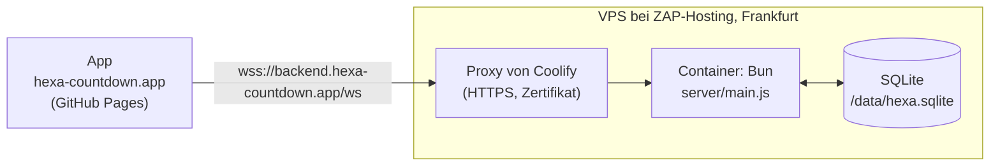

# Umzug auf Bun und eigenen Server – Konzept

> Gehört zu [#16](https://github.com/unpacked-dev/hexa/issues/16). Stand: 23. Oktober 2026. Die Annahmen unter [Vorab geprüft](#vorab-geprüft) sind mit Bun 1.3.11 und Docker ausprobiert, nicht nur nachgelesen.

## Kurz gesagt

- Der Online-Server zieht von **Deno Deploy mit Deno KV** auf **Bun in einem Docker-Container**. Betrieben wird er mit **Coolify** auf dem eigenen VPS bei **ZAP-Hosting** in Frankfurt. Die App auf GitHub Pages bleibt, wie sie ist.
- Statt Deno KV speichert der Server alles in **einer SQLite-Datei** auf einem Volume. Laufende Spiele überstehen so jedes Update.
- Es gibt nur noch **einen Server**. Damit fällt alles weg, was es nur für mehrere Instanzen gab: Beobachten, Nachfragen, Lebenszeichen, gemerkte Versionen und Wiederholen bei Konflikten. Der Server wird spürbar kürzer und einfacher.
- **Online ist seit dem 23. Oktober 2026 aus** und bleibt es bis zum Umzug. Es gibt keinen Datenexport aus Deno KV. Die Statistik fängt auf dem neuen Server bei null an.
- Der Umzug geht **zusammen mit #13 bis #15 als Version 1.17.0** live. Die Produktion spricht noch Protokoll 2. Protokoll 3 für die eigenen Würfel (#14) gibt es nur auf dem Neben-Branch, und der Deno-Server bekommt nichts Neues mehr. Die App spricht weiter mit `wss://backend.hexa-countdown.app/ws`.
- Gearbeitet wird wie immer auf dem Neben-Branch. `main` bekommt den Bun-Server erst am Umzugstag.
- Die [Anleitung Schritt für Schritt](#anleitung-schritt-für-schritt) führt durch alles: neues Projekt in Coolify anlegen, testen, umziehen, Online wieder an und Deno Deploy löschen.

## Entschieden

- Bun im Docker-Container, Coolify, VPS bei ZAP-Hosting in Frankfurt am Main (14.10.2026).
- Der Server liefert die App weiter selbst aus, jetzt über Bun (14.10.2026).
- Für Deno wird nichts mehr entwickelt, auch keine neuen Funktionen am Server vor dem Umzug (23.10.2026).
- Kein Export aus Deno KV. Online wird abgeschaltet, die KV nach dem Umzug gelöscht. Laufende Spiele gibt es dann keine, die Zähler der Statistik dürfen verloren gehen. Konten gibt es ohnehin nicht (23.10.2026).
- Die Online-Logik wird vereinfacht, weil alle Verbindungen über denselben Server laufen (23.10.2026).
- Coolify läuft schon auf dem VPS, eingerichtet und abgesichert, zusammen mit anderen Projekten mit Bun. Für HEXA kommt nur ein neues Projekt dazu (23.10.2026).
- Online ist ab sofort aus, bis der Server auf dem VPS läuft. Erledigt am 23.10.2026, siehe [Online deaktivieren](#online-deaktivieren-erledigt).
- Testadresse ist `hexa.unpacked.dev`. `hexa-countdown.app` bleibt die reine Adresse für die Produktion. `unpacked.dev` zeigt mit allen Subdomains schon auf den VPS (23.10.2026).
- Der Server hört auf Port 3000, dem Standard von Coolify und Bun (23.10.2026).
- Der AVV mit ZAP-Hosting läuft getrennt in [#7](https://github.com/unpacked-dev/hexa/issues/7) und hält den Umzug nicht auf (23.10.2026).

## Was anders ist als im Issue

| Im Issue #16 | Jetzt | Warum |
|---|---|---|
| Kleiner Nachbau von Deno KV (`server/kv.js`) auf SQLite | SQLite direkt, mit zwei einfachen Tabellen | Mit einem Server braucht es weder Versionen noch `watch`. Ein Nachbau würde eine tote API am Leben halten. |
| Statistik aus Deno KV exportieren | Kein Export | Entschieden. Ging auch nicht so einfach: Laut Deno-Doku kommt man an die KV des neuen Deno Deploy nicht von außen heran. |
| `js/config.js`, `rules.js`, `bot.js` laufen in Bun unverändert | Laufen, aber der Server muss sie anders laden | Siehe [Vorab geprüft](#vorab-geprüft), Punkt 1 |
| IP für die Bremsen: `X-Forwarded-For` prüfen | Letzter Eintrag von `X-Forwarded-For`, nur wenn die Anfrage vom Proxy kommt | Sonst teilen sich alle Leute eine Adresse, und die Bremsen greifen für alle |
| Image `oven/bun` | `oven/bun:1.3.11-alpine` | Kleiner, und `wget` ist dabei. Den braucht der Health Check von Coolify. |
| Fliegender Wechsel per DNS | Online ist bis zum Umzug aus | Einfacher und ohne Lobbys, die halb auf dem alten und halb auf dem neuen Server hängen |
| Umzug ohne neue App-Version | Umzug zusammen mit Version 1.17.0 | Die Produktion spricht noch Protokoll 2. #14 braucht Protokoll 3, und das bringt nur der neue Server. |

## Vorab geprüft

Ausprobiert mit Bun 1.3.11 hier in der Sandbox und mit den offiziellen Docker-Images.

1. **Die gemeinsamen Dateien aus `js/` kommen so nicht an.** `server/game.js` lädt sie heute mit `import '../js/config.js'` und liest dann `globalThis.HexaConfig`. In Bun bleibt das leer: Bun erkennt `module.exports` in den Dateien und behandelt sie als CommonJS. Dann landet alles in `module.exports` und nicht auf `globalThis`. **Lösung:** `import Config from '../js/config.js'` (ebenso `Rules` und `Bot`). Im Browser und in Node ändert sich nichts. Mit dieser kleinen Änderung laufen **alle 24 Tests der Spiellogik** unter Bun. Betroffen sind `server/game.js`, `server/main.js` (`enableOnline`) und zwei Stellen in den Tests.
2. **`bun test` ohne Pfad findet auch die App-Tests** in `tests/` (die mit `node:test`). Die laufen in Bun sogar, 41 von 41. Trotzdem bekommt der Server eigene Befehle: `bun test server/`. Die App-Tests bleiben bei `node --test`.
3. **SQLite in Bun** (`bun:sqlite`, SQLite 3.51): WAL und `INSERT … ON CONFLICT … DO UPDATE` funktionieren. Drei Prozesse haben gleichzeitig je 2000-mal gelesen, gerechnet und geschrieben, mit Schreibsperre (`BEGIN IMMEDIATE`). Am Ende standen genau 6000 da, nichts ging verloren. **Wichtig:** `busy_timeout` muss vor dem Umschalten auf WAL gesetzt werden. Sonst bricht der zweite Prozess beim Start mit „database is locked“ ab.
4. **`Bun.serve`** mit WebSocket (`server.upgrade(req, { data })`, `ws.data`) und `server.requestIP(req)` läuft wie erwartet.
5. **Docker-Image:** `oven/bun:1.3.11-alpine` hat 153 MB (`slim` hat 255 MB). Es bringt `wget` mit, `slim` hat weder `curl` noch `wget`. Den Nutzer `bun` (uid 1000) gibt es. Zeitzone `Europe/Berlin` und deutsches Zahlenformat stimmen, das braucht die Statistik.
6. **Anhalten:** Ohne eigene Behandlung von `SIGTERM` braucht `docker stop` 10,2 Sekunden, weil Bun das Signal ignoriert und am Ende hart beendet wird. Mit Behandlung sind es 0,16 Sekunden.

## Zielbild



## Der Server mit Bun

### Was sich ändert

| Heute (Deno) | Mit Bun |
|---|---|
| `Deno.serve(hub.handle)` | `Bun.serve({ port, fetch, websocket })`. `createHub` liefert `fetch` und `websocket` dafür. |
| `Deno.upgradeWebSocket` mit `socket.onmessage`, `onclose` | `server.upgrade(req, { data: c })`, dazu `websocket: { open, message, close }`. Die Verbindung `c` steckt in `ws.data`. |
| `info.remoteAddr.hostname` | `server.requestIP(req)`, hinter dem Proxy `X-Forwarded-For` (siehe unten) |
| `Deno.readFile` | `Bun.file(…)` |
| `Deno.env.get` | `process.env` |
| `Deno.openKv` | `openDb(pfad)` aus dem neuen `server/db.js` |
| `Deno.KvU64` in `stats.js` | Fällt weg, SQLite zählt mit normalen Zahlen |
| `import.meta.main` | Bleibt, Bun kennt es auch |
| `Deno.test` | `import { test } from 'bun:test'` |
| `deno.json` | `package.json` mit `dev`, `start` und `test`, ohne Abhängigkeiten |

`crypto.subtle`, `structuredClone`, `Response.json`, `Intl` und `fetch` laufen in Bun unverändert.

### Datenbank: SQLite statt Deno KV

Zwei Tabellen in einer Datei. Den Pfad bestimmt `HEXA_DB`, im Container `/data/hexa.sqlite`, lokal `./hexa.sqlite`, in Tests `:memory:`.

```sql
CREATE TABLE rooms (
  code    TEXT PRIMARY KEY,    -- KXMP
  data    TEXT NOT NULL,       -- ganzer Stand als JSON, wie heute
  expires INTEGER NOT NULL     -- ms, danach gilt die Lobby als weg
);
CREATE TABLE stats (
  scope  TEXT NOT NULL,        -- day | hour | total
  bucket TEXT NOT NULL,        -- 2026-10-12 | 2026-10-12T14 | ''
  kind   TEXT NOT NULL,        -- online | local | daily
  n      INTEGER NOT NULL,
  PRIMARY KEY (scope, bucket, kind)
);
```

- **Lobby ändern** wird ein einziger Schritt mit Schreibsperre: lesen, rechnen, schreiben. `bun:sqlite` arbeitet synchron, dazwischen kann nichts anderes passieren. Es braucht also keine Versionen, kein Wiederholen und keinen gemerkten Stand. Eine Lobby zu lesen dauert lokal Mikrosekunden statt 15 bis 45 ms wie bei Deno KV.
- **Neue Lobby:** Code ziehen, prüfen, ob er frei ist, anlegen. Auch das in einem Schritt.
- **Statistik:** Ein Spiel zählen sind drei `INSERT … ON CONFLICT DO UPDATE SET n = n + 1` in einem Schritt. Lesen geht mit `SUM(n)` und `WHERE bucket >= ?`. Alte Stunden löscht ein einfaches `DELETE`.
- **Aufräumen:** Einmal pro Stunde `DELETE FROM rooms WHERE expires < jetzt`. Die eigene Prüfung `isLive` bleibt.
- **Einstellungen beim Öffnen**, in dieser Reihenfolge: `busy_timeout = 5000`, `journal_mode = WAL`, `synchronous = NORMAL`.
- Die Funktionen in `store.js` und `stats.js` behalten ihre Namen (`createRoom`, `mutate`, `readRoom`, `countGame`, `readStats`, `pruneHours`, `statsPage`). So ändert sich `main.js` wenig, und die meisten Tests behalten ihre Prüfungen.
- Das Präfix `hexa_` fällt weg. Die Datei gehört nur HEXA.

### Online-Logik vereinfachen

Alle Verbindungen laufen über denselben Server. Das fällt weg:

| Fällt weg | Wo | Ersatz |
|---|---|---|
| Beobachten mit `kv.watch()` und Nachfragen alle 5 Sekunden (`watchRoom`, `HEXA_POLL_MS`) | `store.js`, `main.js` | Nichts. Der Server verteilt jeden neuen Stand direkt nach der Änderung, wie heute schon. |
| Lebenszeichen der Instanzen (`heartbeat`, `liveInstances`, `forgetInstance`, `hexa_instance`, Takt alle 10 Sekunden) | `store.js`, `main.js` | Nichts |
| Gemerkter Stand mit Version (`known`, `L.entry`, `versionstamp`) | `store.js`, `main.js` | Nichts, SQLite ist schnell genug |
| Wiederholen bei Konflikten (12 Versuche mit kurzen Pausen) | `store.js` | Schreibsperre |
| „Eine andere Instanz war schneller“ und der Zufallsversatz bei den Timern | `main.js` | Nichts |
| Verbindungen fremder Instanzen aufräumen | `game.js` (`prune`) | Bleibt, aber einfacher: Nur die eigene Instanz läuft. Verbindungen von vor einem Neustart fallen nach 40 Sekunden weg. |

Zusammen sind das gut 100 Zeilen weniger in `main.js` und `store.js`. **Gleich bleiben** Spiellogik (`game.js`), Protokoll, Nachrichten, Fehlercodes, Bots, Zugzeit und Bremsen.

**Warum die Schreibsperre trotzdem nötig ist:** Bei jedem Update startet Coolify den neuen Container, wartet auf den Health Check und hält erst dann den alten an. Für ein paar Sekunden laufen also zwei Server an derselben Datei. Mit der Schreibsperre geht dabei nichts verloren (siehe Punkt 3 oben). Wer in diesen Sekunden am alten Server hängt, sieht Züge vom neuen erst nach dem Wiederverbinden. Das passiert gleich danach, weil der alte Server beim Anhalten alle Verbindungen schließt.

### IP-Adresse hinter dem Proxy

Die Bremsen zählen pro Internetverbindung (höchstens 20 Verbindungen, 6 neue Lobbys pro Minute). Hinter dem Proxy von Coolify sieht `server.requestIP` aber nur die Adresse des Proxys. Dann würden sich alle Leute eine Adresse teilen, und die Bremsen griffen für alle zugleich.

- Kommt die Anfrage aus einem privaten Netz (also vom Proxy), nimmt der Server den **letzten** Eintrag von `X-Forwarded-For`. Den hängt der Proxy selbst an, fälschen lässt er sich nicht.
- Kommt sie direkt, zählt die Adresse der Verbindung.
- Port 3000 des Containers wird nicht nach außen freigegeben. So geht niemand am Proxy vorbei.
- `ipKey` (IPv6 pro /64-Netz) bleibt, wie es ist. Dazu kommt ein Test für die neue Regel.

### Sauber anhalten

`docker stop` schickt `SIGTERM`. Ohne eigene Behandlung ignoriert Bun das als erster Prozess im Container und wird nach 10 Sekunden hart beendet (siehe [Vorab geprüft](#vorab-geprüft), Punkt 6). Deshalb:

- Bei `SIGTERM` keine neuen Verbindungen mehr annehmen, alle WebSockets mit `1001` schließen, die Datenbank schließen, beenden.
- Die App verbindet sich von selbst neu (nach 0,4 Sekunden, dann immer etwas später, höchstens alle 8 Sekunden) und bekommt den ganzen Stand.

### Kleinigkeiten

- Der Server hört auf `0.0.0.0`, wie bei Bun üblich. Nur auf `127.0.0.1` würde ihn der Proxy von Coolify nicht erreichen.
- `maxPayloadLength` für WebSockets auf 16 KB. Bun nimmt sonst bis zu 16 MB an, der Server prüft erst danach auf 4096 Zeichen.
- `idleTimeout` bleibt bei 60 Sekunden.
- Deno komprimiert Antworten von selbst, Bun nicht. Das ist egal: In der Produktion leitet die Startseite zur App auf GitHub Pages weiter. Falls nötig, kann der Proxy von Coolify komprimieren.
- `REDIRECT_HOSTS` nur noch mit `backend.hexa-countdown.app`.
- `hexa.sqlite*` kommt in die `.gitignore`.

## Tests

- `Deno.test(…)` wird zu `test(…)` aus `bun:test`. Die Prüfungen mit `node:assert` bleiben.
- **Zeitlimit:** Bun bricht einen Test nach 5 Sekunden ab, Deno nicht. Ganze Partien über WebSocket dauern länger. Deshalb `bun test --timeout 30000 server/`.
- Tests mit zwei Instanzen laufen künftig mit einem Server. Die Tests für Beobachten, Lebenszeichen und gemerkten Stand fallen weg.
- Die Test-Server laufen immer mit `online: true`, egal was in `js/config.js` steht. Auf `main` ist das seit dem Abschalten schon so, sonst wären dort 11 Server-Tests gescheitert.
- **Neu:**
  - Neustart: Ein zweiter Server an derselben Datei übernimmt eine laufende Lobby, die Leute verbinden neu und spielen weiter.
  - IP hinter dem Proxy: letzter Eintrag von `X-Forwarded-For`, aber nur aus einem privaten Netz.
  - Sauber anhalten: Verbindungen gehen mit `1001` zu.
- **CI:** Der Job „Server-Tests“ nutzt `oven-sh/setup-bun@v2` mit fester Version und `bun run test`. Dazu kommt ein Schritt `docker build`, damit ein kaputtes Dockerfile sofort auffällt. Die App-Tests bleiben bei Node.

## Dockerfile

So steht es im Hauptordner:

```dockerfile
# HEXA – Online-Server. Läuft mit Coolify auf dem eigenen Server, siehe server/README.md.
# Die Bun-Version zusammen mit .github/workflows/ci.yml ändern.
FROM oven/bun:1.3.11-alpine
WORKDIR /app
ENV NODE_ENV=production PORT=3000 HEXA_DB=/data/hexa.sqlite

# Keine Pakete, also kein bun install. Nur was der Server braucht und an die Apps ausliefert.
COPY server/*.js server/
COPY js/ js/
COPY css/ css/
COPY lang/ lang/
COPY fonts/ fonts/
COPY icons/ icons/
COPY index.html sw.js manifest.webmanifest favicon.svg ./

# Hier liegt die Datenbank. Das Volume übernimmt beim ersten Start den Besitzer dieses Ordners.
RUN mkdir -p /data && chown bun:bun /data
USER bun

EXPOSE 3000
# wget gibt es im Alpine-Image. Coolify nimmt diesen Health Check von selbst.
HEALTHCHECK --interval=10s --timeout=3s --start-period=5s --retries=3 \
  CMD wget -q -O /dev/null http://127.0.0.1:3000/health || exit 1
CMD ["bun", "server/main.js"]
```

- Dazu eine `.dockerignore` (`.git`, `docs/`, `tools/`, `tests/`, `server/tests/`), damit nur wenig zum Bauen geschickt wird.
- Coolify nimmt den `HEALTHCHECK` aus dem Dockerfile von selbst.
- Lokal prüfen mit `docker build` und `docker run` samt Volume: App öffnen, Lobby erstellen, Container neu starten, Lobby ist noch da.

## Branches

- **`main`** ist die Produktion: Version 1.16.0 mit Protokoll 2. GitHub Pages und Deno Deploy bauen jeden Push. Seit dem 23.10.2026 steht dort `enableOnline: false`. Sonst kommt bis zum Umzug nichts mehr auf `main`.
- **Neben-Branch** `claude/charming-maxwell-yrwmwc`: Hier wird wie immer gearbeitet. Dort liegen schon #13 bis #15, jetzt kommt der Bun-Server dazu. Online bleibt hier an, damit die Testadresse online spielt.
- `main` bis zum Umzug **nicht** in den Neben-Branch holen. Sonst wäre Online auch auf der Testadresse aus.
- **Am Umzugstag** holt Claude `main` in den Neben-Branch. Die Zeile mit `enableOnline` hat nur `main` geändert, darum steht danach auch im Neben-Branch `false`. Gibt es in `js/config.js` einen Konflikt, etwa weil der Kommentar darüber geändert wurde, bleibt `enableOnline: false`. Danach wird `main` wie bei jedem Release auf den Neben-Branch nachgezogen.
- Bis Ende Januar muss niemand warten. Sobald Testlauf und AVV fertig sind, kann umgezogen werden.

## Anleitung Schritt für Schritt

| Phase | Was | Wer | Dauer, etwa |
|---|---|---|---|
| [A](#a-code-im-branch) | Code im Branch ✅ | Claude | |
| [B](#b-repo-in-coolify-freigeben) | Repo in Coolify freigeben ✅ | du | 5 Minuten |
| [C](#c-testadresse-einrichten) | Neues Projekt in Coolify, Testadresse einrichten ✅ | du | 15 Minuten |
| [D](#d-auf-echten-geräten-testen) | Auf echten Geräten testen ✅ | du | 1 Stunde |
| [E](#e-avv-mit-zap-hosting) | AVV mit ZAP-Hosting: getrennt in #7 | du | |
| [F](#f-umzugstag) | Umzugstag: umziehen, Online wieder an, Release 1.17.0 | du, Claude für die Commits | 1 bis 2 Stunden |
| [G](#g-deno-deploy-löschen) | Deno Deploy löschen | du | 10 Minuten |
| [H](#h-nacharbeiten) | Nacharbeiten | du und Claude | |

Coolify läuft schon auf dem VPS, eingerichtet und abgesichert, zusammen mit anderen Projekten mit Bun. Für HEXA kommt nur ein neues Projekt dazu.

A läuft gleichzeitig mit B, C und E. Für D müssen A und C fertig sein, für F alles davor.

Die Namen von Knöpfen und Feldern in Coolify und Deno Deploy stammen aus deren Doku (Oktober 2026). Je nach Version können sie leicht abweichen.

**Einstellungen auf einen Blick** (für C und F):

| | Test | Produktion |
|---|---|---|
| Name in Coolify | `hexa-test` | `hexa` |
| Branch | `claude/charming-maxwell-yrwmwc` (Neben-Branch) | `main` |
| Domain | `https://hexa.unpacked.dev` | `https://backend.hexa-countdown.app` |
| Build Pack | Dockerfile | Dockerfile |
| Ports Exposes | `3000` (Standard in Coolify) | `3000` |
| Port Mappings | leer | leer |
| Persistent Storage | Volume `hexa-test-data` nach `/data` | Volume `hexa-data` nach `/data` |
| Umgebungsvariablen | keine | keine |
| Health Check | aus dem Dockerfile | aus dem Dockerfile |

Port Mappings bleiben leer, sonst klappen die Updates ohne Pause nicht, und man käme am Proxy vorbei.

### Online deaktivieren (erledigt)

Erledigt am 23.10.2026 mit Commit `c7b6848` auf `main`. So geht es, falls es noch einmal nötig ist:

1. Auf GitHub `js/config.js` auf `main` öffnen, Stift (*Edit this file*).
2. `enableOnline: true,` ändern in `enableOnline: false,`.
3. *Commit changes…* → *Commit directly to the main branch*, eine kurze Nachricht → *Commit changes*. Oder Claude sagen: „Online aus“.
4. Warten, bis unter *Actions* „pages build and deployment“ grün ist (1 bis 2 Minuten) und der Server neu gebaut ist.
5. **Prüfen:** `https://backend.hexa-countdown.app/health` zeigt `"online":false`. Die App unter hexa-countdown.app zweimal neu laden. Ein Tipp auf „Online“ zeigt „Online spielen ist gerade pausiert.“

Was dann passiert: In der App ist „Online“ ausgegraut. Wer gerade online spielt, landet mit einem Hinweis im Hauptmenü. Der Server nimmt keine Verbindungen mehr an. Lokale Spiele und das Tagesspiel laufen ganz normal weiter.

### A. Code im Branch

1. Auf dem Neben-Branch `claude/charming-maxwell-yrwmwc` arbeiten. Vor jedem Push laufen alle Tests (`bun run test`, `node --test`) und `docker build`. Die CI läuft nur auf `main` und in PRs.
2. **Server auf Bun:** `server/db.js`, `store.js` und `stats.js` auf SQLite. `main.js` auf `Bun.serve`. Online-Logik vereinfachen, IP hinter dem Proxy, sauber anhalten, Imports aus `js/`. Dazu ein kleines `server/backup.js` für Phase H. Alle Tests auf `bun:test`.
3. `package.json` mit `dev`, `start` und `test`. CI auf Bun, mit `docker build`. `deno.json` löschen.
4. `Dockerfile` und `.dockerignore`. Lokal bauen und starten: App öffnen, Lobby erstellen, Container neu starten, die Lobby ist noch da.
5. **Doku und Kommentare,** damit `main` nach dem Umzug gleich stimmt:
   - `server/README.md`: Einrichten mit Coolify statt Deno Deploy, Betrieb, Abschnitt zu mehreren Instanzen raus, Umgebungsvariablen, Tabellen.
   - `README.md`: Technik, Projektstruktur, lokal starten mit `bun run dev`, Tests mit `bun run test`.
   - `docs/online-konzept.md`: Hinweis zum Stand.
   - `CHANGELOG.md`: Eintrag unter „Geändert“, im Abschnitt `[Unreleased]` neben #13 bis #15.
   - Kommentare, die Deno nennen: `js/config.js` (auch der Hinweis zum kostenlosen Tarif bei `enableOnline`), `js/online.js`, `js/bot.js`, `js/daily.js`.

**Fertig, wenn** alle Tests grün sind und der Container lokal läuft.

**Erledigt am 23.10.2026.** Das ist dabei herausgekommen:

- Die Funktionen für die Datenbank arbeiten synchron, wie `bun:sqlite` selbst. Jede Änderung an einer Lobby ist damit ein einziger Schritt.
- 54 Server-Tests laufen mit `bun run test`: 24 für die Spiellogik, 7 für die Datenbank (mit Neustart, zwei Servern an einer Datei und Backup), 6 für die Statistik, 17 für den ganzen Server (mit Neustart mitten im Spiel und der IP hinter dem Proxy). Fünf Durchläufe hintereinander, alle grün. Die 41 App-Tests mit `node --test` laufen unverändert.
- **Container lokal geprüft:**
  - Der Health Check wird „healthy“.
  - Unter `backend.hexa-countdown.app` leitet die Startseite weiter.
  - `docker stop` dauert 270 ms.
  - Nach dem Tausch auf einen neuen Container mit demselben Volume geht das laufende Spiel weiter.
  - `bun server/backup.js` schreibt die Kopie nach `/data`.
- **Im Browser geprüft:** Zwei Fenster spielen mit der echten App über den Bun-Server. Nach einem Neustart mitten im Spiel ist die App nach 0,5 Sekunden von selbst wieder verbunden, in derselben Lobby und im selben Zug. Fehler im Browser gab es keine.
- Eine Änderung an einer vollen Lobby (50 Personen) dauert 0,13 ms.
- **Eigenheit von Bun:** Der WebSocket-Client von Bun meldet den Code 1001 als 1000. Browser und Node sehen 1001, die App braucht den Code nicht. Der Test prüft deshalb den Grund „Server hält an“.
- Die Bremse für `/count` gilt jetzt für den ganzen Server. Früher hatte jede Instanz ihre eigene.

### B. Repo in Coolify freigeben

Die GitHub App von Coolify gibt es schon für deine anderen Projekte. Es fehlt höchstens der Zugriff auf dieses Repo.

1. In Coolify unter *Sources* deine GitHub App öffnen und nachsehen, ob `unpacked-dev/hexa` bei den Repositories steht.
2. Falls nicht: dort zu GitHub wechseln (*Repositories* bzw. *Update Repositories*), bei *Repository access* `unpacked-dev/hexa` hinzufügen und speichern. Zurück in Coolify die Liste neu laden.

**Fertig, wenn** `unpacked-dev/hexa` in der Liste steht. **Erledigt am 23.10.2026.**

### C. Testadresse einrichten

1. **DNS:** Nichts zu tun. `unpacked.dev` zeigt mit allen Subdomains schon auf den VPS. Kurz prüfen: `dig +short hexa.unpacked.dev` zeigt die IP des VPS.
2. **Neues Projekt:** In Coolify *Projects → + Add*, Name `HEXA`. Die Umgebung `production` öffnen.
3. *+ New* → *Private Repository (with GitHub App)* → derselbe Server wie bei deinen anderen Projekten → deine GitHub App → Repository `unpacked-dev/hexa` → *Load Repository*.
4. Branch `claude/charming-maxwell-yrwmwc`, Build Pack *Dockerfile*, Base Directory `/`, Port `3000` (steht schon so da) → *Continue*.
5. Unter *Configuration* die Werte aus der Spalte „Test“ der Tabelle oben eintragen: Name, Domain, *Ports Exposes*, *Port Mappings* leer. Speichern. Die Domain steht je nach Version unter *General* oder auf einer eigenen Seite *Domains* (*Add domain*).
6. *Persistent Storage* → *Add* → *Volume Mount*: Name `hexa-test-data`, *Destination Path* `/data`. Speichern.
7. *Deploy* und in den *Deployment Logs* zuschauen. Der erste Build dauert ein bis zwei Minuten.
8. **Prüfen:**
   - `https://hexa.unpacked.dev/health` zeigt `{"app":"hexa","protocol":3,"online":true,"ok":true}`.
   - Das Schloss im Browser ist da, das Zertifikat stimmt.
   - `https://hexa.unpacked.dev/` zeigt die App selbst. Sie spielt über den Server der Testadresse.

Ab jetzt baut jeder Push auf den Neben-Branch die Testadresse neu. Dort ist Online an. Die Testadresse spielt also online, obwohl Online in der Produktion aus ist.

**Fertig, wenn** die App unter der Testadresse läuft. **Erledigt am 23.10.2026:** `hexa.unpacked.dev` läuft mit Zertifikat von Let's Encrypt. Von außen geprüft: `/health`, App-Dateien, gesperrte Pfade, ein Online-Spiel mit zwei Personen und Bot. Auf dem Server vergehen pro Aktion etwa 2 ms.

### D. Auf echten Geräten testen

Zwei Geräte, eins im WLAN, eins mit Mobilfunk. Beide öffnen `https://hexa.unpacked.dev`.

- [ ] Lobby erstellen, beitreten, Reihenfolge ändern, eine ganze Partie
- [ ] Bots in allen drei Stufen, ein Countdown
- [ ] Eigene Würfel: eintragen, korrigieren, überspringen
- [ ] Neuladen mitten im Spiel, Handy sperren und entsperren, „Zum Hauptmenü“ und zurück
- [ ] **Update mitten im Spiel:** In Coolify *Redeploy* drücken. Nach kurzem Neuverbinden läuft das Spiel weiter.
- [ ] **Neustart mitten im Spiel:** In Coolify *Restart* drücken. Die Lobby ist noch da.
- [ ] Beide Geräte erstellen kurz nacheinander je eine Lobby. Keins bekommt „Zu viele Versuche“. (Prüft die IP hinter dem Proxy.)
- [ ] `https://hexa.unpacked.dev/stats` zählt die gestarteten Spiele.

Klappt etwas nicht: Claude Bescheid geben. Die Korrektur kommt in den Neben-Branch, die Testadresse baut von selbst neu.

**Fertig, wenn** alle Haken gesetzt sind. **Erledigt am 23.10.2026,** auf echten Geräten getestet.

### E. AVV mit ZAP-Hosting

Läuft getrennt in [#7](https://github.com/unpacked-dev/hexa/issues/7) und hält den Umzug nicht auf (entschieden am 23.10.2026).

### F. Umzugstag

Online ist schon aus. Laufende Spiele gibt es also keine, und nichts eilt.

**Am Tag vorher**

1. **TTL senken (optional):** Bei Spaceship die TTL des Eintrags `backend` von 30 Minuten (heute) auf 5 Minuten setzen, mindestens 30 Minuten vor Schritt 5. Ohne das dauert es nach Schritt 5 bis zu 30 Minuten, bis alle die neue Adresse sehen. Weil Online ohnehin aus ist, schadet das Warten niemandem.
2. **Geprüft am 23.10.2026,** nichts mehr zu tun:
   - IPv4 des VPS: `185.249.198.192` (wie bei `unpacked.dev`).
   - Kein AAAA-Eintrag nötig, auch `unpacked.dev` hat keinen.
   - Keine CAA-Einträge bei `hexa-countdown.app`, Let's Encrypt darf also ausstellen.

**Am Umzugstag**

3. **Release vorbereiten** (Claude): `main` in den Neben-Branch holen, damit steht `enableOnline: false` auch dort. Dabei den Kommentar über `enableOnline` in `js/config.js` anpassen, er nennt noch Deno Deploy. Er steht direkt über der Zeile, die `main` geändert hat, und bleibt bis dahin, damit es keinen Konflikt gibt. Abschnitt `## [1.17.0]` in `CHANGELOG.md` mit #13 bis #15 und dem Umzug. Alle Tests grün.
4. **`main` nachziehen** (Claude), wie bei jedem Release. GitHub Pages bringt die App 1.17.0, noch mit Online aus. Deno Deploy baut `main` auch, der Bun-Code läuft dort aber nicht. Das ist egal, Online ist ja aus. Nur die Meldungen lokaler Spiele an die Statistik gehen bis Schritt 7 verloren.
5. **DNS umstellen** bei Spaceship:
   - CNAME `backend` → `alias.deno.net` löschen.
   - Neu: A `backend` → `185.249.198.192`, TTL 5 Minuten.
   - CNAME `_acme-challenge.backend` löschen.
6. **Warten,** bis `dig +short backend.hexa-countdown.app` die IP des VPS zeigt, auch bei öffentlichen DNS-Servern (Google, Cloudflare). Mit gesenkter TTL meist 5 bis 10 Minuten, sonst bis zu 30. Von außen prüfen geht auch mit [dnschecker.org](https://dnschecker.org). Erst dann weiter, sonst scheitert in Schritt 7 das Zertifikat.
7. **Produktion in Coolify anlegen,** wie C2 bis C7, mit den Werten aus der Spalte „Produktion“: Name `hexa`, Branch `main`, Domain `https://backend.hexa-countdown.app`, Volume `hexa-data` nach `/data`. *Deploy*. Erst jetzt, weil Coolify sofort ein Zertifikat holt. Das klappt nur, wenn der DNS-Eintrag schon auf den VPS zeigt.
8. **Prüfen:**
   - `https://backend.hexa-countdown.app/health` zeigt `{"app":"hexa","protocol":3,"online":false,"ok":true}`, das Schloss ist da.
   - `https://backend.hexa-countdown.app/stats` lädt und zeigt Nullen.
   - `https://backend.hexa-countdown.app/` leitet weiter zu hexa-countdown.app.
9. **Online aktivieren.**
   - Am einfachsten: Claude sagen „Online an“. Claude setzt `enableOnline: true` auf dem Neben-Branch und zieht `main` nach.
   - Oder selbst auf GitHub: `js/config.js` auf `main` öffnen, Stift (*Edit this file*), `enableOnline: false,` ändern in `enableOnline: true,` → *Commit changes…* → *Commit directly to the main branch*, Nachricht `Online wieder an: Server läuft auf eigenem VPS` → *Commit changes*. Danach holt Claude `main` in den Neben-Branch.
   - Coolify baut von selbst neu (1 bis 2 Minuten), GitHub Pages auch.
   - **Prüfen:** `/health` zeigt `"online":true`. Die App unter hexa-countdown.app zweimal neu laden, „Online“ ist wieder wählbar.
10. **Prüfen:** Unter hexa-countdown.app mit zwei Geräten online spielen, mit Bot und einmal mit eigenen Würfeln. `/stats` zählt die Spiele. In Coolify bei `hexa` die *Logs* ansehen: keine Fehler.
11. **Release:** Auf GitHub *Actions → Release → Run workflow*, Version `1.17.0`. Das Release bekommt die Notizen aus `CHANGELOG.md` und die ZIP-Datei.

Online ist bis Schritt 9 aus. Lokale Spiele und das Tagesspiel laufen die ganze Zeit normal.

**Wenn etwas nicht klappt:** Online bleibt einfach aus, bis es läuft. Zurück auf Deno lohnt sich nicht, dort fehlt Protokoll 3.

**Fertig, wenn** online gespielt werden kann, `/stats` zählt und das Release 1.17.0 veröffentlicht ist.

### G. Deno Deploy löschen

Direkt nach dem Umzug, sobald F10 geklappt hat. Einen Weg zurück zu Deno gibt es ohnehin nicht mehr.

1. **App löschen:** Auf [console.deno.com](https://console.deno.com) in der Organisation die App `hexa` öffnen → *Settings* → App löschen und bestätigen. Alle Deployments hören sofort auf, die Verbindung zur eigenen Domain fällt weg. Wer sich vertan hat: Der Deno-Support kann eine App 30 Tage lang wiederherstellen.
2. **Domain löschen:** Oben links auf die Organisation → Tab *Domains* → `backend.hexa-countdown.app` öffnen → *Delete* → bestätigen.
3. **Datenbank löschen:** Unter *Databases* bei `unpacked` nachsehen, ob noch andere Apps zugewiesen sind.
   - Keine anderen: *Delete* → bestätigen. Das löscht alle Daten darin.
   - Andere Apps nutzen sie: stehen lassen. Die Einträge von HEXA stören nicht und verschwinden mit Deno Deploy.
4. **GitHub aufräumen:** Auf GitHub *Settings → Applications → Installed GitHub Apps* → Deno Deploy → den Zugriff auf `unpacked-dev/hexa` entfernen. Nutzt sie sonst nichts, die App ganz deinstallieren.
5. **DNS prüfen:** Kein Eintrag zeigt mehr auf Deno. `backend` zeigt auf den VPS, `_acme-challenge.backend` gibt es nicht mehr.

**Fertig, wenn** bei Deno nichts mehr von HEXA übrig ist.

### H. Nacharbeiten

1. **Backup:** In Coolify bei `hexa` → *Scheduled Tasks* → *Add*: Name `backup`, Command `bun server/backup.js`, Frequency `0 4 * * *`. Speichern, *Execute Now*, unter *Recent executions* prüfen, dass es geklappt hat. Das Skript schreibt jede Nacht eine Kopie nach `/data/backup-<datum>.sqlite` und löscht Kopien, die älter als 7 Tage sind. Wichtig sind nur die Zähler der Statistik, Lobbys leben höchstens 24 Stunden. Eine Kopie außerhalb des VPS ist möglich, aber nicht nötig.
2. **TTL zurück:** Bei Spaceship die TTL von `backend` wieder auf 1 Stunde.
3. **Testadresse behalten:** `hexa-test` baut weiter aus dem Neben-Branch und zeigt immer den nächsten Stand vor dem Release, wie früher die Testadressen von Deno Deploy.
4. **Issues:** [#16](https://github.com/unpacked-dev/hexa/issues/16) und [#9](https://github.com/unpacked-dev/hexa/issues/9) (Grenzen des kostenlosen Tarifs) schließen. Im Datenschutztext ([#6](https://github.com/unpacked-dev/hexa/issues/6)) steht später ZAP-Hosting in Frankfurt als Hoster statt Deno in den USA.
5. **Optional:** In Coolify *Watch Paths* setzen, damit reine Doku-Änderungen keinen neuen Build auslösen.
6. **Einmal im Monat:** In Coolify oder per SSH (`df -h`, `free -h`) Arbeitsspeicher, CPU und Platz ansehen.

## Risiken

| Risiko | Folge | Dagegen |
|---|---|---|
| Beim Update laufen kurz zwei Server an derselben Datei | Ohne Sperre könnten Züge verloren gehen | Schreibsperre, alter Server schließt Verbindungen sofort, Test dafür |
| Bremsen sehen nur die Adresse des Proxys | Alle werden gemeinsam gebremst | `X-Forwarded-For` wie oben, Test dafür, auf der Testadresse mit zwei Netzen (WLAN und Mobilfunk) ausprobieren |
| Zertifikat klappt nach dem DNS-Wechsel nicht | Online bleibt länger aus | Port 80 offen, CAA prüfen, Produktion erst nach dem DNS-Wechsel anlegen (F7). Online bleibt aus, bis es klappt. |
| VPS fällt aus | Online geht nicht | Benachrichtigung von Coolify. Lokal spielen geht weiter. |
| Platte voll | Server kann nicht schreiben | Lobbys räumen sich auf, die Statistik ist winzig. Einmal im Monat schauen. |
| Neue Bun-Version verhält sich anders | Tests oder Server brechen | Version fest im Dockerfile und in der CI, nur bewusst und zusammen erhöhen |

## Offen

- Nutzen andere Apps der Organisation die Datenbank „unpacked“ auf Deno Deploy (G3)?
- Reicht ein tägliches Backup auf dem VPS selbst (H1)?

## Quellen

- Ankündigung zu Deno und Cloudflare, Deno Deploy noch sechs Monate: [deno.com/blog/cloudflare](https://deno.com/blog/cloudflare)
- Kein Zugriff von außen auf die KV des neuen Deno Deploy: [docs.deno.com/deploy/kv/node](https://docs.deno.com/deploy/kv/node/)
- Health Checks in Coolify brauchen `curl` oder `wget` im Image, `HEALTHCHECK` aus dem Dockerfile: [coolify.io/docs/applications/configuration/health-checks](https://coolify.io/docs/applications/configuration/health-checks)
- Updates ohne Pause in Coolify, ohne Port-Mapping: [coolify.io/docs/applications/deployments/rolling-updates](https://coolify.io/docs/applications/deployments/rolling-updates)
- GitHub App in Coolify, Zugriff auf Repos: [coolify.io/docs/applications/ci-cd/github/setup-app](https://coolify.io/docs/applications/ci-cd/github/setup-app)
- Anwendung mit Dockerfile, Server muss auf `0.0.0.0` hören: [coolify.io/docs/applications/builds/dockerfile](https://coolify.io/docs/applications/builds/dockerfile)
- Persistent Storage: [coolify.io/docs/knowledge-base/persistent-storage](https://coolify.io/docs/knowledge-base/persistent-storage)
- Scheduled Tasks: [coolify.io/docs/applications/operations/scheduled-tasks](https://coolify.io/docs/applications/operations/scheduled-tasks)
- App auf Deno Deploy löschen: [docs.deno.com/deploy/reference/apps](https://docs.deno.com/deploy/reference/apps/)
- Domain auf Deno Deploy löschen: [docs.deno.com/deploy/reference/domains](https://docs.deno.com/deploy/reference/domains/)
- Deno-KV-Datenbank löschen: [docs.deno.com/deploy/reference/deno_kv](https://docs.deno.com/deploy/reference/deno_kv/)
